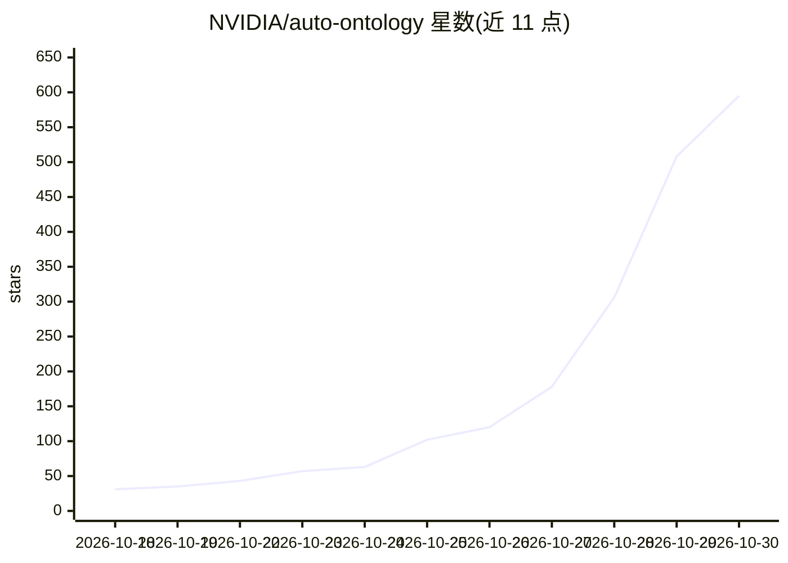

# NVIDIA/auto-ontology

⭐ 595 · Python · Apache-2.0 · 推送 2026-10-29 · [GitHub](https://github.com/NVIDIA/auto-ontology) · 组织维护

**从企业元数据构建语义本体层、供 agent 可信查询的框架**

NVIDIA 维护的 Python 框架，用于在关系型数据源上构建语义目录/本体层与知识图谱：从元数据生成本体，调和跨系统定义，校验生成的 SQL 查询并返回来源，通过 MCP、CLI 与 API 向 agent 框架暴露上下文。技术栈为 Next.js 前端 + FastAPI 后端 + Postgres/pgvector，推理走 NVIDIA NIM 端点（托管 API 或自托管 NIM）。支持 Docker Compose 与 Kubernetes Helm 部署，提供 Web UI、SSO/RBAC、API token 与对话式 NL-to-SQL。注意：未配置 Vault 时连接凭据以明文存于 Postgres；项目不接收外部贡献。

## 筛选速览

| 维度 | 判定 | 备注 |
|---|---|---|
| AI 角色 | `ai-ecosystem` | LLM/agent 周边工具 |
| 许可风险 | `permissive` | Apache-2.0 |
| 部署形态 | `self-host` | docker 或自建部署 |
| 模型依赖 | — | README 未给出锁定关系 |
| 硬件要求 | — | 无带数字的原话,不猜 |
| 安装摩擦 | `low` | 无编译、无系统依赖或容器化 |
| 成熟度 | — | 结构信号不足 |

## 能力要点

- 从企业元数据生成本体并调和跨系统定义
- 查询校验与每次回答附带 lineage 溯源
- 通过 MCP/CLI/API 服务于任意 agent 框架
- Docker Compose 与 Kubernetes Helm 两种部署方式

## 适用场景

- 让 agent 用可信的业务口径查询企业数据库
- 统一多个系统中不一致的指标与实体定义
- 在 Cursor/Claude Desktop 等 agent 中通过 MCP 查询数据

## 场景标签

`知识图谱` `数据分析` · 领域:效率与自动化

## 证据(README 行号)

> L3: Agents can retrieve documents and query databases, but reliability gates agentic analytics: a revenue metric answere
> L10: - Expose: serve context to any agent harness through MCP, CLI, and API.
> L256: Agent harnesses such as Cursor and Claude Desktop can query your data through

## 星数曲线

2026-10-18 31 → 2026-10-30 595（+564）

---
*卡片 v1 · prompt 1.4 · 生成 2026-10-24 · 置信度 high · 依据 README sha `efd502942cc9` · [字段定义](../../DATASET.md)*
