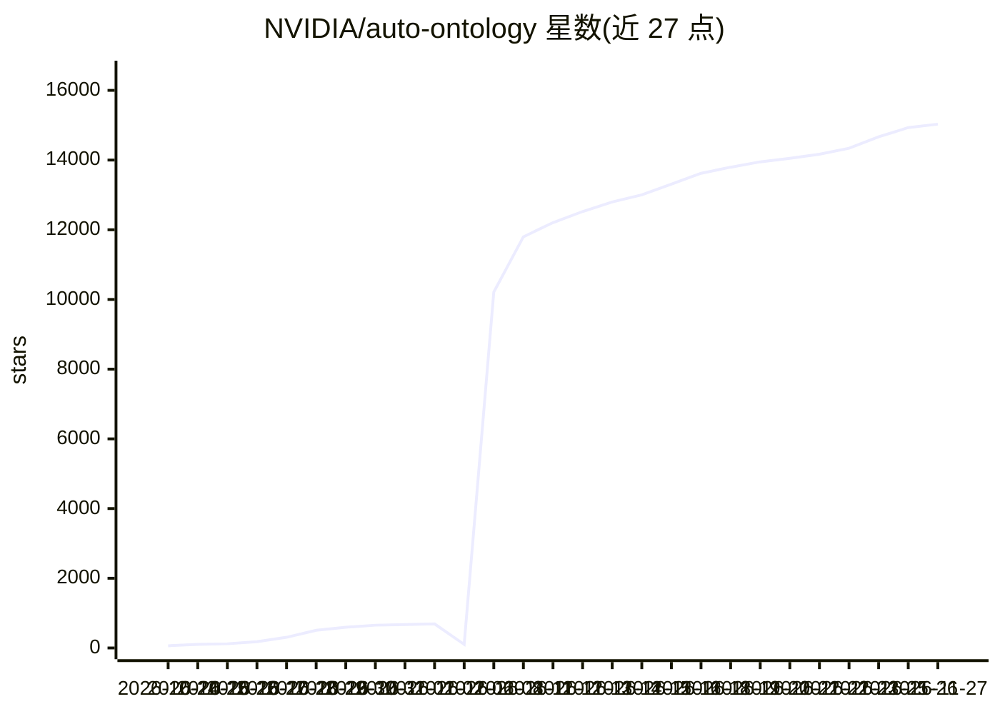

# NVIDIA/auto-ontology

⭐ 15,031 · Python · Apache-2.0 · 推送 2026-11-26 · [GitHub](https://github.com/NVIDIA/auto-ontology) · 组织维护

**从企业元数据自动构建语义本体层，供 LLM/Agent 通过 MCP 检索与查询**

NVIDIA 开源的 Python 框架：从数据库目录元数据自动生成本体（概念、映射、关系、指标、血缘、认证六类元素），存入 Postgres+pgvector，经语义编译后以 MCP、CLI 与 API 暴露给任意 agent harness。回答流程中模型在 retrieve/run_sql/submit 工具间循环，查询前按目录校验表名列名，答案附带 SQL 与推导步骤；支持 Ossie YAML 导入导出。部署依赖 Docker Compose v2、uv 与 NVIDIA API key。

## 筛选速览

| 维度 | 判定 | 备注 |
|---|---|---|
| AI 角色 | `ai-ecosystem` | LLM/agent 周边工具 |
| 许可风险 | `permissive` | Apache-2.0 |
| 部署形态 | `self-host` | docker 或自建部署 |
| 模型依赖 | — | README 未给出锁定关系 |
| 硬件要求 | — | 无带数字的原话,不猜 |
| 安装摩擦 | `low` | 无编译、无系统依赖或容器化 |
| 成熟度 | — | 结构信号不足 |

## 能力要点

- 从元数据自动生成本体草稿，人工认证后复用，含血缘与 SQL 指标
- 通过 FastMCP 向任意 MCP 客户端提供只读工具，按用户权限执行
- 答案返回 SQL 与步骤，SQL 执行前对照目录与检索结果校验
- 兼容 Apache Ossie 语义模型开放标准，支持 YAML 导入导出

## 适用场景

- 为企业数据问答 agent 提供受治理的业务指标定义与口径
- 多源数据定义冲突时统一指标与实体语义
- text-to-SQL 场景要求答案可解释、可回溯 SQL

## 场景标签

`数据分析` `知识图谱` · 领域:效率与自动化

## 证据(README 行号)

> L6: Agents can retrieve documents and query databases, but reliability gates agentic analytics: a revenue metric answere
> L15: - **Expose:** serve context to any agent harness through MCP, CLI, and API.
> L233: The MCP server gives any MCP client read-only

## 星数曲线

2026-10-24 63 → 2026-11-27 15,031（+14,968）

---
*卡片 v1 · prompt 1.4 · 生成 2026-11-26 · 置信度 high · 依据 README sha `f9a3c7788c41` · [字段定义](../../DATASET.md)*
