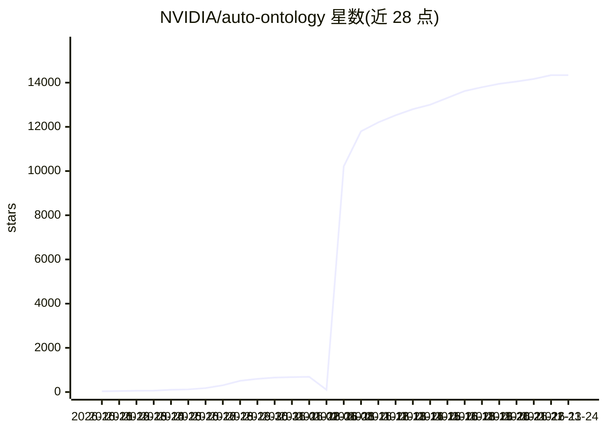

# NVIDIA/auto-ontology

⭐ 14,666 · Python · Apache-2.0 · 推送 2026-11-23 · [GitHub](https://github.com/NVIDIA/auto-ontology) · 组织维护

**为 LLM/agent 工作流自动构建企业本体语义层的 Python 框架**

NVIDIA 开源的 Python 框架，从企业元数据自动生成本体（概念、映射、关系、指标、血缘、认证六要素），供 agent 通过 MCP、CLI、API 检索业务上下文并生成可核验的 text-to-SQL 答案。流程分两阶段：先从数据库摄取并语义编译生成本体草稿，再由推理模型以 retrieve/run_sql/submit 工具循环回答问题，每个答案附 SQL 与步骤，并先检查可答性。技术栈为 Next.js 前端、FastAPI+LangChain 后端、Postgres+pgvector，通过 Docker Compose 部署，需 NVIDIA API key。README 称在 BEAVER 与 BIRD-Interact 基准上排名第一。

## 筛选速览

| 维度 | 判定 | 备注 |
|---|---|---|
| AI 角色 | `ai-ecosystem` | LLM/agent 周边工具 |
| 许可风险 | `permissive` | Apache-2.0 |
| 部署形态 | `self-host` | docker 或自建部署 |
| 模型依赖 | — | README 未给出锁定关系 |
| 硬件要求 | — | 无带数字的原话,不猜 |
| 安装摩擦 | `low` | 无编译、无系统依赖或容器化 |
| 成熟度 | `idea` | |

## 能力要点

- 从企业元数据自动生成本体，含概念、映射、关系、指标、血缘与认证六类元素
- 通过 MCP、CLI、API 向任意 agent harness 暴露语义上下文
- 答案附 SQL 与推导步骤，回答前检查可答性并请求澄清
- 兼容 Apache Ossie 语义模型交换标准，支持 YAML 导入导出

## 适用场景

- 为 text-to-SQL 分析 agent 提供受治理的业务语义层
- 跨多个定义冲突的数据源统一指标口径
- 专家认证前用真实问题测试自动生成的本体草稿

## 场景标签

`数据分析` `知识图谱` · 领域:效率与自动化

## 证据(README 行号)

> L6: Agents can retrieve documents and query databases, but reliability gates agentic analytics: a revenue metric answere
> L15: - **Expose:** serve context to any agent harness through MCP, CLI, and API.
> L213: |Backend|FastAPI (Python 3.12+), LangChain|Text-to-SQL agent, catalog, ontology APIs|3001|

## 星数曲线

2026-10-21 35 → 2026-11-24 14,339（+14,304）

---
*卡片 v1 · prompt 1.4 · 生成 2026-11-24 · 置信度 high · 依据 README sha `0f286505ed29` · [字段定义](../../DATASET.md)*
