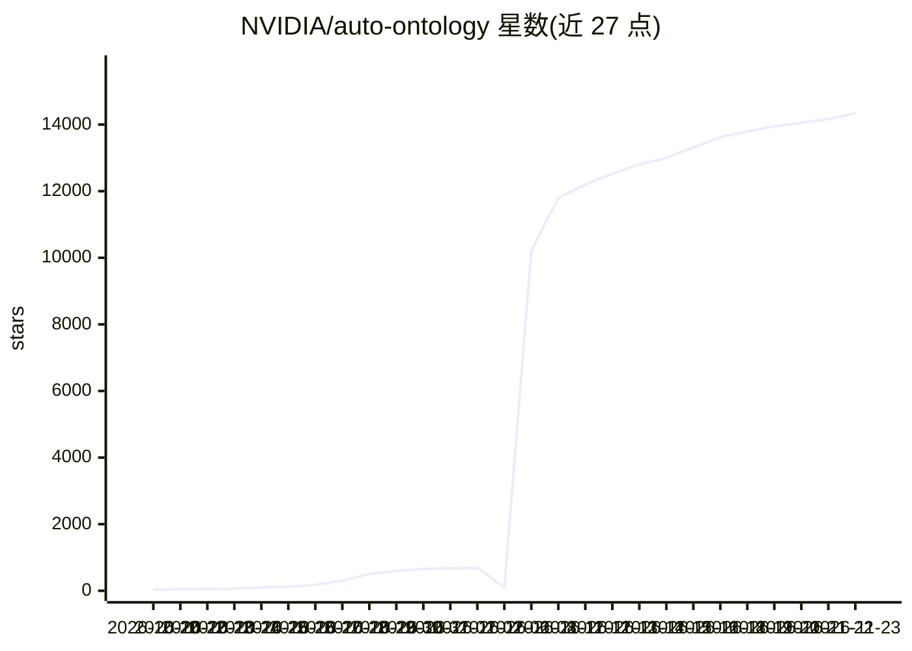

# NVIDIA/auto-ontology

⭐ 14,339 · Python · Apache-2.0 · 推送 2026-11-22 · [GitHub](https://github.com/NVIDIA/auto-ontology) · 组织维护

**从企业元数据自动构建本体，为 LLM/agent 提供可溯源数据上下文**

NVIDIA 开源的 Python 框架，从企业数据库元数据自动生成本体（术语、映射、关系、指标、血缘、认证），经专家认证后通过 MCP、CLI 和 API 向任意 agent 提供业务语义上下文。回答阶段由推理模型在工具循环中检索语义层、校验并运行 SQL，答案附 SQL 与步骤以便核验；不可回答的问题会先做 answerability 检查。部署依赖 Docker Compose、PostgreSQL 17+pgvector 与 NVIDIA API key；兼容 Apache Ossie 语义模型交换标准。

## 筛选速览

| 维度 | 判定 | 备注 |
|---|---|---|
| AI 角色 | `ai-ecosystem` | LLM/agent 周边工具 |
| 许可风险 | `permissive` | Apache-2.0 |
| 部署形态 | `self-host` | docker 或自建部署 |
| 模型依赖 | — | README 未给出锁定关系 |
| 硬件要求 | — | 无带数字的原话,不猜 |
| 安装摩擦 | `low` | 无编译、无系统依赖或容器化 |
| 成熟度 | — | 结构信号不足 |

## 能力要点

- 从数据库元数据自动生成本体草稿，支持专家认证与再编译
- 通过 MCP server（FastMCP）向任意 MCP 客户端提供只读 agent 工具
- 答案返回 SQL、步骤与行数据，支持 CSV 下载与图表展示
- 兼容 Apache Ossie 标准，支持 YAML 导入导出

## 适用场景

- 为企业的数据问答 agent 提供受治理的业务指标定义
- 跨多个数据源统一存在冲突的业务术语口径
- 让 agent 对无法回答的问题先做可答性检查再澄清

## 场景标签

`知识图谱` `数据分析` · 领域:效率与自动化

## 证据(README 行号)

> L6: Agents can retrieve documents and query databases, but reliability gates agentic analytics: a revenue metric answere
> L13: - **Expose:** serve context to any agent harness through MCP, CLI, and API.
> L211: |Backend|FastAPI (Python 3.12+), LangChain|Text-to-SQL agent, catalog, ontology APIs|3001|

## 星数曲线

2026-10-20 35 → 2026-11-23 14,339（+14,304）

---
*卡片 v1 · prompt 1.4 · 生成 2026-11-23 · 置信度 high · 依据 README sha `1da0edd19123` · [字段定义](../../DATASET.md)*
