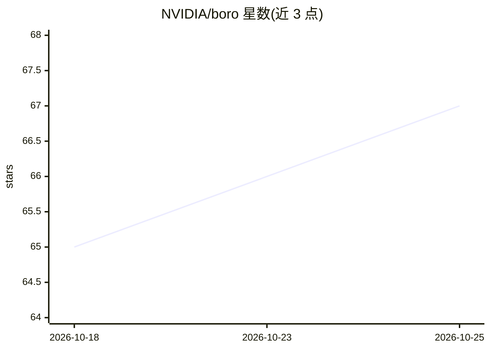

# NVIDIA/boro

⭐ 67 · Rust · Apache-2.0 · 推送 2026-09-19 · [GitHub](https://github.com/NVIDIA/boro) · 组织维护

**面向 Linux 内核开发者的 AI 补丁审查与测试 CLI**

Rust 编写的内核开发辅助 CLI，在开发者本地 git 树上运行：多阶段 agentic 流水线审查提交区间（子系统识别、并发/安全/资源等专项审查、强模型裁决），产出 LKML 风格报告；支持逐提交构建、virtme-ng 启动内核运行 AI 选定的测试、AI 辅助 cherry-pick 冲突解决。通过 OpenAI 兼容端点配置主模型与验证模型（可混合本地/远端），也可用 Claude/OpenCode/Codex 作为 agent 后端。需 b4、virtme-ng 等外部工具，可选 lei。

## 筛选速览

| 维度 | 判定 | 备注 |
|---|---|---|
| AI 角色 | `ai-native` | 本体是模型或模型工具 |
| 许可风险 | `permissive` | Apache-2.0 |
| 部署形态 | `library` | 以包/库形式分发 |
| 模型依赖 | local-ok | 支持本地模型 |
| 硬件要求 | — | 无带数字的原话,不猜 |
| 安装摩擦 | `medium` | 含编译或系统依赖之一 |
| 成熟度 | — | 结构信号不足 |

## 能力要点

- 13 步多阶段审查流水线，主模型发现+验证模型独立裁决
- boro build/test 在 virtme-ng 中真实构建并启动内核运行模型选定的测试
- AI 辅助 cherry-pick：冲突解决由验证模型门控，最多 10 轮
- 主模型与验证模型可指向不同端点，按阶段统计 token

## 适用场景

- 本地审查尚未公开张贴的补丁系列
- 下游内核维护中 backport 提交并自动解决冲突
- 构建补丁提交并在 VM 中运行针对性测试
- 为特定 Kconfig 选项生成或执行测试计划

## 场景标签

`代码审查` · 领域:编码与开发

## 证据(README 行号)

> L5: Boro is an AI-assisted kernel development CLI for developers working inside
> L92: - `boro review COMMIT_RANGE`: multi-stage agent code review using kernel-focused
> L219: Pull the qwen3-coder:30b model with Ollama:

## 星数曲线

2026-10-18 65 → 2026-10-25 67（+2）

---
*卡片 v1 · prompt 1.4 · 生成 2026-10-24 · 置信度 high · 依据 README sha `d4e902c5a819` · [字段定义](../../DATASET.md)*
