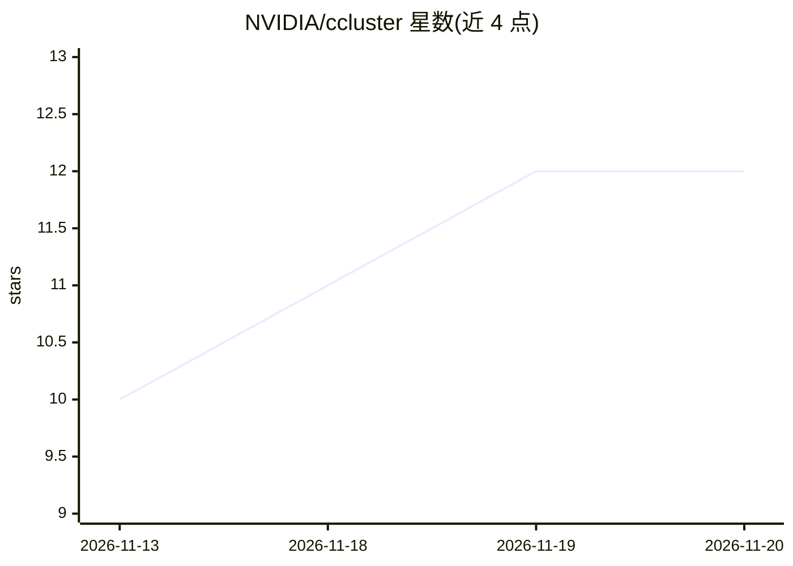

# NVIDIA/ccluster

⭐ 12 · Go · Apache-2.0 · 推送 2026-11-19 · [GitHub](https://github.com/NVIDIA/ccluster) · 组织维护

**AI 团队管理多云 GPU 集群与模型生命周期的 Kubernetes 平台**

NVIDIA 开源的 Kubernetes 原生平台，为 AI 团队提供单一控制平面管理跨云/本地的 GPU 集群：注册基础设施集群、按序部署 Helm chart 目录，覆盖推理、微调、批处理与训练负载。采用控制面/基础设施面双 operator 架构，按团队命名空间隔离凭据与部署，通过 bin-packing、自动伸缩与负载感知调度提高加速器利用率。声明处于早期阶段，当前可用部分为控制面 operator 与 chart 目录；提供 Helm chart、CLI、Go/Python SDK。

## 筛选速览

| 维度 | 判定 | 备注 |
|---|---|---|
| AI 角色 | `ai-ecosystem` | LLM/agent 周边工具 |
| 许可风险 | `permissive` | Apache-2.0 |
| 部署形态 | `library` | 以包/库形式分发 |
| 模型依赖 | — | README 未给出锁定关系 |
| 硬件要求 | — | 无带数字的原话,不猜 |
| 安装摩擦 | `low` | 无编译、无系统依赖或容器化 |
| 成熟度 | `idea` | |

## 能力要点

- 控制面 operator 统一编排多集群的部署与状态收集
- Helm chart 目录含 GPU Operator、cert-manager、Istio、KEDA 等组件
- 按团队命名空间隔离凭据与部署，组件最小权限运行
- 提供 Helm chart、CLI（Linux/macOS, amd64/arm64）、Go 与 Python SDK

## 适用场景

- 统一管理分布在不同云上的 GPU 集群与工作负载
- 通过 GitOps 声明式部署推理与训练服务
- 用 Python SDK 快速部署一个 LLM 推理端点

## 场景标签

`MLOps` · 领域:训练与推理

## 证据(README 行号)

> L6: **An efficiency-focused, Kubernetes-native platform for managing the end-to-end AI lifecycle across distributed, mul
> L22: - **Kubernetes-native.** Everything is expressed as Kubernetes resources and reconciled declaratively (GitOps), so 
> L44: - **The catalog** holds the Helm charts that bring up a functional infra plane for AI

## 星数曲线

2026-11-13 10 → 2026-11-20 12（+2）

---
*卡片 v1 · prompt 1.4 · 生成 2026-11-19 · 置信度 high · 依据 README sha `2ed8462a5c37` · [字段定义](../../DATASET.md)*
