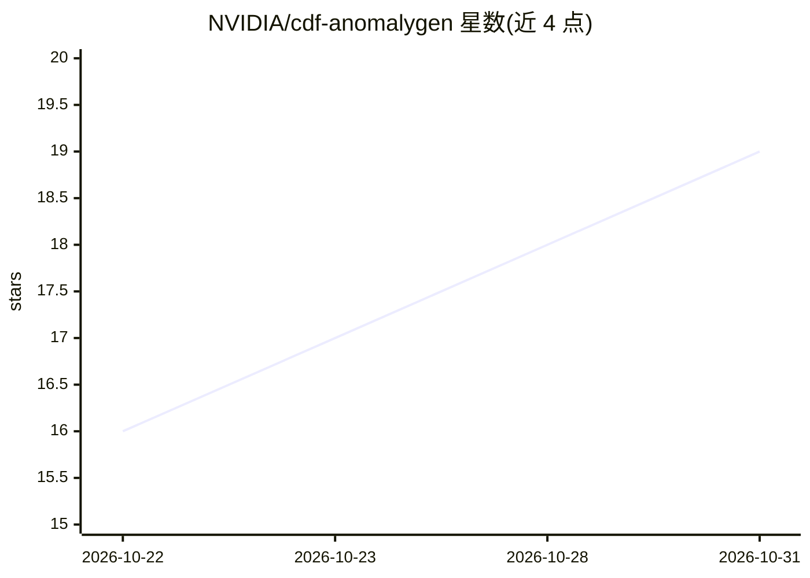

# NVIDIA/cdf-anomalygen

⭐ 19 · Python · Apache-2.0 · 推送 2026-10-20 · [GitHub](https://github.com/NVIDIA/cdf-anomalygen) · 组织维护

**工业检测的少样本合成缺陷图像生成管线（基于扩散模型）**

NVIDIA Cosmos Data Factory 下的合成数据生成管线：给定洁净产品图与缺陷位置掩码，在冻结的 Cosmos 基础生成网络上按缺陷类型微调小型 LoRA，把真实感缺陷绘制到掩码区域。流程含七阶段：数据准备、掩码生成（默认自托管 VLM 提议→评判→精炼的 Agentic Mask Generation，或经典 AMP）、微调、生成、KPI 评估、参数精炼与伪标注（输出 COCO 数据集等）。面向工业视觉检测场景，供训练下游缺陷检测/分割模型使用。需 NVIDIA GPU 与 CUDA，完整检查点约 140 GB，提供 NGC 预构建 Docker 镜像与 agent skill 驱动方式。

## 筛选速览

| 维度 | 判定 | 备注 |
|---|---|---|
| AI 角色 | `ai-native` | 本体是模型或模型工具 |
| 许可风险 | `permissive` | Apache-2.0 |
| 部署形态 | `self-host` | docker 或自建部署 |
| 模型依赖 | — | README 未给出锁定关系 |
| 硬件要求 | — | 无带数字的原话,不猜 |
| 安装摩擦 | `low` | 无编译、无系统依赖或容器化 |
| 成熟度 | — | 结构信号不足 |

## 能力要点

- 冻结基础网络 + 按缺陷类型的小型 LoRA，少量真实样本即可微调
- 七阶段端到端管线：数据准备→掩码生成→微调→生成→评估→精炼→伪标注（COCO）
- 默认 Agentic Mask Generation：自托管 VLM 的提议→评判→精炼循环
- 以 agent skill 形式提供，AI 编码 agent 可用自然语言驱动全流程

## 适用场景

- 工业质检中为缺陷检测器/分割器生成训练用合成缺陷图像
- 缺陷样本稀少时用几张真实图微调后批量合成各类型缺陷
- 把合成缺陷批自动转为 COCO 标注数据集

## 场景标签

`图像生成` · 领域:内容生成

## 证据(README 行号)

> L3: CDF AnomalyGen is a diffusion-based pipeline for **Synthetic Data Generation (SDG)** of anomaly
> L24: 4. **Generation (SDG)** — run the fine-tuned checkpoint over a batch of testcases to synthesize
> L33: 7. **Pseudo-labeling** — turn the refined batch into a labeled dataset: a COCO instance dataset, a

## 星数曲线

2026-10-22 16 → 2026-10-31 19（+3）

---
*卡片 v1 · prompt 1.4 · 生成 2026-10-29 · 置信度 high · 依据 README sha `9ab1e6165ab6` · [字段定义](../../DATASET.md)*
