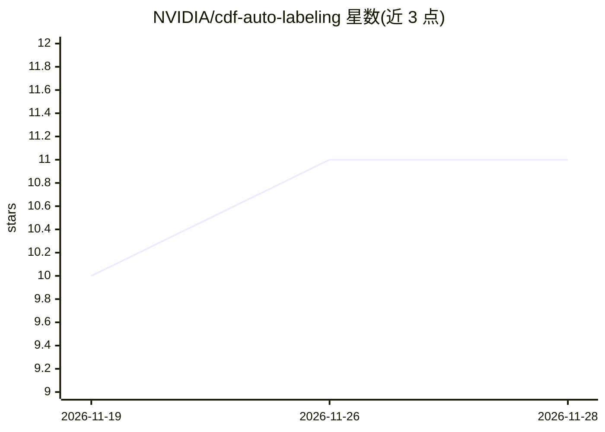

# NVIDIA/cdf-auto-labeling

⭐ 11 · Python · Apache-2.0 · 推送 2026-11-26 · [GitHub](https://github.com/NVIDIA/cdf-auto-labeling) · 组织维护

**把原始图像/视频自动标注为可训练数据集的流水线**

NVIDIA 的 CDF 工作流仓库，将原始图像与视频数据转换为可复用的标注产物与训练就绪输出。流程由 cookbook 驱动：每个 cookbook 定义输入媒体、阶段顺序、模型端点、检查点挂载、提示词与问题库；workflow runner 将其编译为本地容器执行计划，结果写入共享 DAFT 场景目录。阶段涵盖超分辨率、检测与跟踪、描述生成、视觉问答、推理、2D grounding 等。前置要求 Python 3.12+、uv、GNU Make，容器流程需 Docker 或 Podman 及 GPU 运行时；项目当前不接受贡献。

## 筛选速览

| 维度 | 判定 | 备注 |
|---|---|---|
| AI 角色 | `ai-native` | 本体是模型或模型工具 |
| 许可风险 | `permissive` | Apache-2.0 |
| 部署形态 | `None` |  |
| 模型依赖 | — | README 未给出锁定关系 |
| 硬件要求 | — | 无带数字的原话,不猜 |
| 安装摩擦 | `low` | 无编译、无系统依赖或容器化 |
| 成熟度 | — | 结构信号不足 |

## 能力要点

- cookbook 驱动的容器化标注流水线，支持自定义数据集与标注目标
- 阶段包含超分辨率、检测跟踪、VQA、推理、2D grounding、视觉属性搜索等
- 支持通过 make pull 从 NGC 拉取预构建镜像或本地构建
- 输出遵循统一 DAFT 场景目录与 DataEntry JSONL 契约

## 适用场景

- 将原始视频/图像数据批量转换为微调训练数据集
- 适配 cookbook 以处理新数据集或新标注目标
- 校验各阶段输出与产物契约后打包标注用于下游训练或人工复核

## 场景标签

`图像视频处理` · 领域:感知与多模态

## 证据(README 行号)

> L5: Auto-Labeling is the CDF workflow repository for turning raw
> L7: outputs. It composes containerized stages for super resolution, detection and
> L13: for a complete labeling workflow. The workflow runner compiles those cookbooks

## 星数曲线

2026-11-19 10 → 2026-11-28 11（+1）

---
*卡片 v1 · prompt 1.4 · 生成 2026-11-20 · 置信度 high · 依据 README sha `33460300baa4` · [字段定义](../../DATASET.md)*
