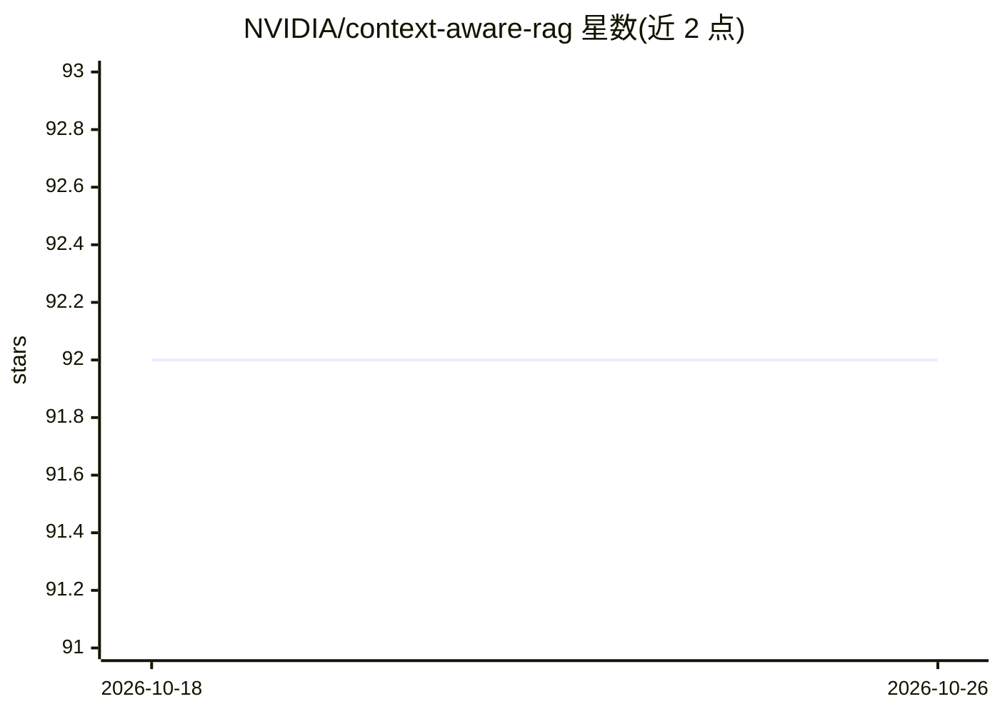

# NVIDIA/context-aware-rag

⭐ 92 · Python · Apache-2.0 · 推送 2026-10-20 · [GitHub](https://github.com/NVIDIA/context-aware-rag) · 组织维护

**NVIDIA 的 RAG 管道库：数据摄取、检索与知识图谱构建**

Context Aware RAG（CA-RAG）是 NVIDIA 维护的库，面向已有数据处理工作流的开发者，用于构建定制化的 RAG 数据摄取与检索管道。核心功能包括数据摄取服务、自然语言检索服务、GraphRAG 知识图谱抽取、自定义函数/工具组件，以及基于 OpenTelemetry 的可观测性；实验特性含结构化输出模式与 5 个 MCP 工具（用于 agent 工作流）。通过 git clone 源码 + uv 安装，可选 Arango/NAT 插件，亦提供 Docker Compose 部署（含 Neo4j、Milvus、Elasticsearch 等配套服务）。

## 筛选速览

| 维度 | 判定 | 备注 |
|---|---|---|
| AI 角色 | `ai-ecosystem` | LLM/agent 周边工具 |
| 许可风险 | `permissive` | Apache-2.0 |
| 部署形态 | `self-host` | docker 或自建部署 |
| 模型依赖 | — | README 未给出锁定关系 |
| 硬件要求 | — | 无带数字的原话,不猜 |
| 安装摩擦 | `low` | 无编译、无系统依赖或容器化 |
| 成熟度 | — | 结构信号不足 |

## 能力要点

- 数据摄取服务支持多来源数据接入 RAG 管道
- GraphRAG 从数据中抽取知识图谱
- 实验特性：结构化输出模式与 5 个 MCP 工具（agent 工作流）
- 支持任意 OpenTelemetry 兼容监控工具的观测能力

## 适用场景

- 在现有数据处理工作流中接入 RAG 摄取与检索
- 构建基于知识图谱的 GraphRAG 管道
- 通过 MCP 工具在 AI agent 工作流中使用 RAG 能力

## 场景标签

`RAG` `知识图谱` · 领域:知识与检索

## 证据(README 行号)

> L5: Context Aware RAG is a flexible library designed to seamlessly integrate into existing data processing workflows to 
> L10: - **Data Retrieval Service:** Retrieve data from the RAG pipeline using natural language queries.
> L12: - **GraphRAG:** Seamlessly extract knowledge graphs from data to support your existing workflows.

## 星数曲线

2026-10-18 92 → 2026-10-26 92（+0）

---
*卡片 v1 · prompt 1.4 · 生成 2026-10-23 · 置信度 mid · 依据 README sha `5f71c169c645` · [字段定义](../../DATASET.md)*
