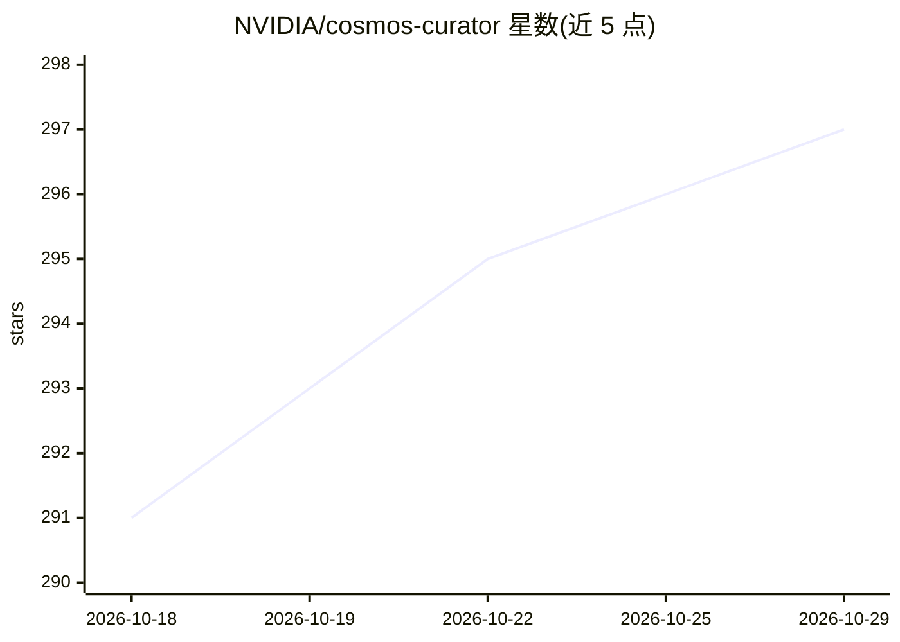

# NVIDIA/cosmos-curator

⭐ 297 · Python · Apache-2.0 · 推送 2026-10-16 · [GitHub](https://github.com/NVIDIA/cosmos-curator) · 组织维护

**物理 AI 训练数据治理工具包：视频切分、标注、过滤、去重**

NVIDIA 维护的物理 AI 训练数据治理工具包，面向构建数据流水线的团队。提供视频切分、标注、过滤、去重与数据集生成功能，支持基于多模型家族的 AI 视频分析，通过 Ray Data（及原有 Cosmos-Xenna）实现分布式处理，并支持云端部署（含 NVIDIA Cloud Functions）。新工作流入口 Curator Next 结合参考 recipe 与共享组件、使用 Lance 数据集；其 API 与数据契约为孵化期演进状态，旧有 Xenna 与 Ray Data 流水线计划在过渡后退役。以 git clone 加子模块方式获取源码运行。

## 筛选速览

| 维度 | 判定 | 备注 |
|---|---|---|
| AI 角色 | `ai-ecosystem` | LLM/agent 周边工具 |
| 许可风险 | `permissive` | Apache-2.0 |
| 部署形态 | `None` |  |
| 模型依赖 | — | README 未给出锁定关系 |
| 硬件要求 | — | 无带数字的原话,不猜 |
| 安装摩擦 | `low` | 无编译、无系统依赖或容器化 |
| 成熟度 | `idea` | |

## 能力要点

- 视频切分、标注、过滤、去重与数据集生成
- 基于多模型家族的 AI 视频分析
- Ray Data / Cosmos-Xenna 分布式处理与云端集成
- Curator Next 提供参考 recipe 与共享组件、Lance 数据集

## 适用场景

- 为机器人/物理 AI 准备与清洗视频训练数据
- 搭建分布式视频数据治理流水线
- 按参考 recipe 快速启动新的数据治理工作流

## 场景标签

`图像视频处理` `MLOps` · 领域:感知与多模态

## 证据(README 行号)

> L7: A toolkit for curating physical AI training data.
> L16: Cosmos Curator helps teams build physical AI data curation workflows from reusable components and reference recipes
> L27: - **AI-Powered Analysis**: Advanced video analysis using multiple model families

## 星数曲线

2026-10-18 291 → 2026-10-29 297（+6）

---
*卡片 v1 · prompt 1.4 · 生成 2026-10-21 · 置信度 high · 依据 README sha `309fab278efc` · [字段定义](../../DATASET.md)*
