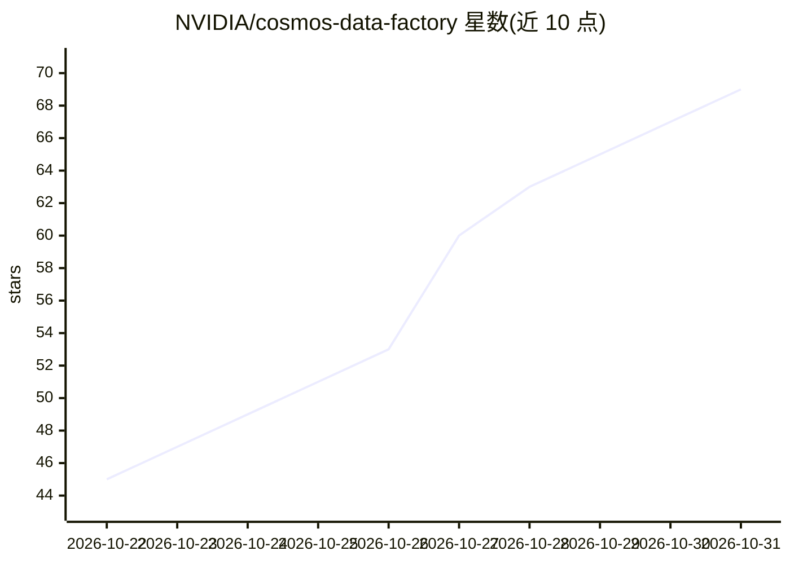

# NVIDIA/cosmos-data-factory

⭐ 69 · NOASSERTION · 推送 2026-10-30 · [GitHub](https://github.com/NVIDIA/cosmos-data-factory) · 组织维护

**物理 AI 合成数据生成工作流：把真实数据变成带标注的训练集**

NVIDIA Cosmos Data Factory 提供一组 agent 驱动的蓝图与可组合技能，在自有 GPU（本地或云端）上对数据进行整理、富化、标注、增强与生成，产出大规模带标注的物理 AI 训练数据。包含 5 个参考蓝图（自动驾驶数据生成、缺陷图像生成、事件视频生成等）与 6 个核心技能，通过 CDF Orchestration 以 Airflow DAG 运行，支持 Kubernetes。部署需要 Kubernetes 集群、对象存储、容器仓库、NGC API key 与 Hugging Face token；各蓝图 GPU 数量 0-8 不等。另提供 Cosmos Evaluator 质量校验与 LoRA 微调配方。

## 筛选速览

| 维度 | 判定 | 备注 |
|---|---|---|
| AI 角色 | `ai-native` | 本体是模型或模型工具 |
| 许可风险 | `none` | NOASSERTION |
| 部署形态 | `None` |  |
| 模型依赖 | — | README 未给出锁定关系 |
| 硬件要求 | — | 无带数字的原话,不猜 |
| 安装摩擦 | `low` | 无编译、无系统依赖或容器化 |
| 成熟度 | — | 结构信号不足 |

## 能力要点

- 5 个参考蓝图覆盖驾驶数据、缺陷生成、事件视频、属性增强与视频增强
- 核心技能可单独使用或编排为自定义 DAG 管线
- Cosmos Evaluator 校验合成视频的物理准确性与幻觉等指标
- 提供 Sim2Real 与 AnomalyGen 的 LoRA 微调配方

## 适用场景

- 为检测模型生成稀缺的缺陷样本训练数据
- 把现有行车录像按天气/光照条件增强并自动标注
- 从一张种子图生成火灾、跌倒等罕见事件的标注视频

## 场景标签

`工作流自动化` `图像生成` `视频生成` · 领域:效率与自动化

## 证据(README 行号)

> L3: NVIDIA Cosmos Data Factory (CDF) is a set of agent-driven blueprints and composable skills that turn real data into 
> L25: |**Auto Labeling**|Turns raw video and images into annotated datasets — detection, tracking, captions and scene und
> L71: |*"I have a driving scenario to improve my autonomous driving. Curate data, retrieve similar clips, and generate ra

## 星数曲线

2026-10-22 45 → 2026-10-31 69（+24）

---
*卡片 v1 · prompt 1.4 · 生成 2026-10-24 · 置信度 high · 依据 README sha `b33207b93a3a` · [字段定义](../../DATASET.md)*
