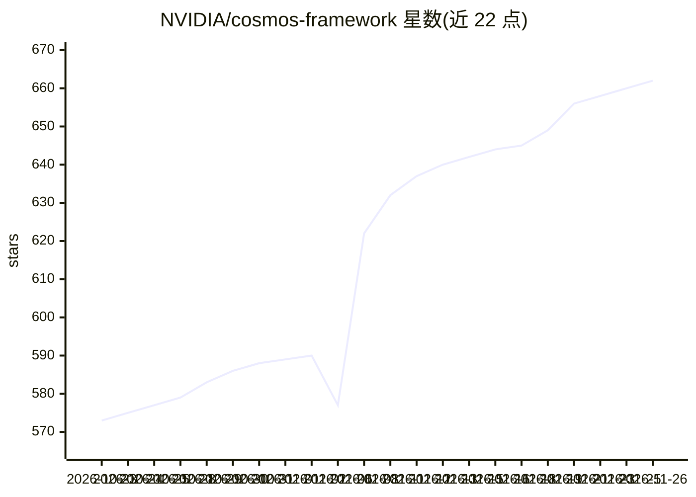

# NVIDIA/cosmos-framework

⭐ 662 · Python · NOASSERTION · 推送 2026-11-24 · [GitHub](https://github.com/NVIDIA/cosmos-framework) · [官网](https://nvidia.github.io/cosmos-framework/) · 组织维护

**NVIDIA Cosmos 世界模型的训练与推理部署框架**

NVIDIA Cosmos 项目家族中的训练与服务框架，以单一 Python 包 cosmos_framework/ 组织：训练侧提供 FSDP/TP/CP/PP 分布式训练器、DCP 检查点与 JSONL/WebDataset/LeRobot 数据集适配器；推理侧支持 Diffusers/Transformers/vLLM 后端的离线批量生成与在线服务（Ray + Gradio）；另含策略服务（server-client 管线）与后训练/强化学习运行时（DPO/GRPO/PPO/OPD/SFT 等算法）。以 uv 安装，依赖 CUDA 环境，示例配方为 8×H100 配置。

## 筛选速览

| 维度 | 判定 | 备注 |
|---|---|---|
| AI 角色 | `ai-ecosystem` | LLM/agent 周边工具 |
| 许可风险 | `none` | NOASSERTION |
| 部署形态 | `None` |  |
| 模型依赖 | local-ok | 支持本地模型 |
| 硬件要求 | — | 无带数字的原话,不猜 |
| 安装摩擦 | `medium` | 含编译或系统依赖之一 |
| 成熟度 | — | 结构信号不足 |

## 能力要点

- 训练与推理统一于单一 cosmos_framework/ Python 包
- Diffusers/Transformers/vLLM 三种推理后端，支持离线批量与在线服务
- 后训练/RL 运行时覆盖 DPO、GRPO、PPO、蒸馏等算法
- 内置面向编码 agent 的 AgentSkills（SKILL.md）与 AGENTS.md 仓库地图

## 适用场景

- 在多 GPU 集群上对 Cosmos3 系列世界模型做微调与后训练
- 将训练好的 Cosmos3 检查点部署为推理服务或策略服务器
- 为机器人具身策略做强化学习优化

## 场景标签

`微调` `推理引擎` `强化学习` · 领域:训练与推理

## 证据(README 行号)

> L6:  Part of the NVIDIA Cosmos project family — the training and serving framework repository.
> L10: **Cosmos-Framework** is an end-to-end framework for training and serving world models, including the **Cosmos3** mo
> L13: - **Inference** — Diffusers / Transformers / vLLM backends with offline batch generation and online serving (Ray + 

## 星数曲线

2026-10-23 573 → 2026-11-26 662（+89）

---
*卡片 v1 · prompt 1.4 · 生成 2026-11-24 · 置信度 high · 依据 README sha `0623696b0963` · [字段定义](../../DATASET.md)*
