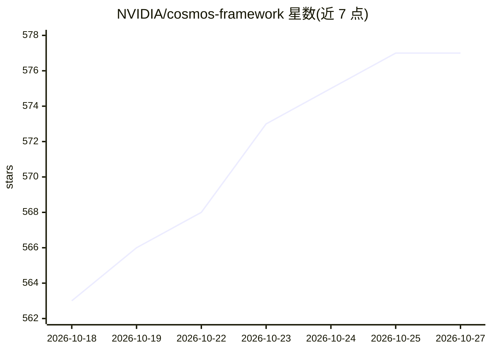

# NVIDIA/cosmos-framework

⭐ 577 · Python · NOASSERTION · 推送 2026-10-26 · [GitHub](https://github.com/NVIDIA/cosmos-framework) · [官网](https://nvidia.github.io/cosmos-framework/) · 组织维护

**NVIDIA 世界模型的训练与推理服务框架（Cosmos3）**

单一 cosmos_framework Python 包内提供端到端能力：分布式训练（FSDP/TP/CP/PP，DCP 检查点，JSONL/WebDataset/LeRobot 数据适配）、推理（Diffusers/Transformers/vLLM 后端，离线批生成与 Ray+Gradio 在线服务）、策略服务部署及后训练与 RL（DPO/GRPO/PPO/OPD/DiffusionNFT/SFT），面向 Cosmos3 模型家族并扩展支持 Qwen、GR00T、π0.5 等模型。安装需 uv 指定 CUDA 变体依赖组及系统依赖，示例配方在 8×H100 80GB 上测试。

## 筛选速览

| 维度 | 判定 | 备注 |
|---|---|---|
| AI 角色 | `ai-ecosystem` | LLM/agent 周边工具 |
| 许可风险 | `none` | NOASSERTION |
| 部署形态 | `None` |  |
| 模型依赖 | local-ok | 支持本地模型 |
| 硬件要求 | — | 无带数字的原话,不猜 |
| 安装摩擦 | `medium` | 含编译或系统依赖之一 |
| 成熟度 | — | 结构信号不足 |

## 能力要点

- 分布式 FSDP/TP/CP/PP 训练器与 DCP 检查点（safetensors 导入导出）
- Diffusers/Transformers/vLLM 推理后端，支持离线批生成与 Ray+Gradio 在线服务
- 后训练与 RL 算法运行时（DPO/GRPO/PPO/OPD/DiffusionNFT）及策略服务
- 附带面向编码 agent 的 SKILL.md 技能集

## 适用场景

- 在自己的数据上微调或蒸馏 Cosmos3 世界模型
- 多 GPU/多节点训练与在线推理服务部署世界模型
- 对 Qwen 等兼容模型做 SFT 与偏好优化、强化学习

## 场景标签

`微调` `推理引擎` `强化学习` `模型训练` · 领域:训练与推理

## 证据(README 行号)

> L10: **Cosmos-Framework** is an end-to-end framework for training and serving world models, including the **Cosmos3** mo
> L12: - **Training** — distributed FSDP / TP / CP / PP trainer, native DCP checkpoints with HuggingFace `safetensors` imp
> L13: - **Inference** — Diffusers / Transformers / vLLM backends with offline batch generation and online serving (Ray + 

## 星数曲线

2026-10-18 563 → 2026-10-27 577（+14）

---
*卡片 v1 · prompt 1.4 · 生成 2026-10-21 · 置信度 high · 依据 README sha `cf3531402eac` · [字段定义](../../DATASET.md)*
