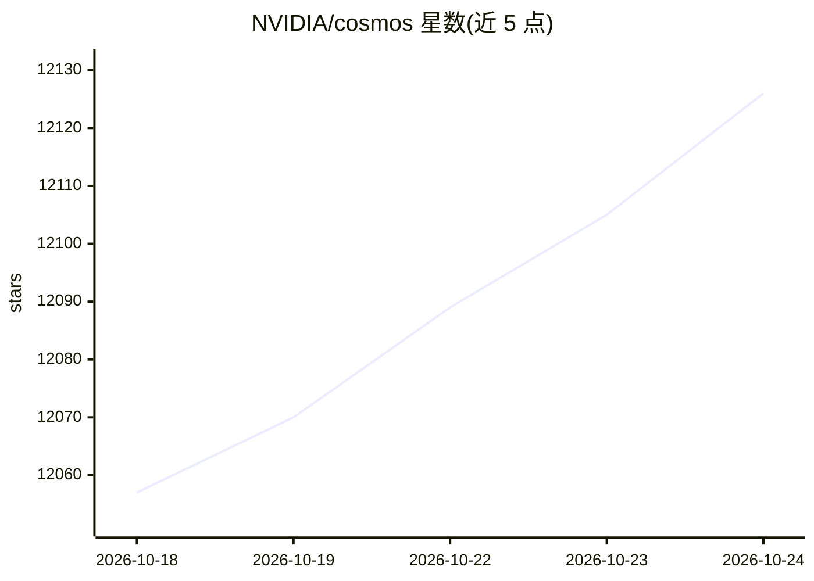

# NVIDIA/cosmos

⭐ 12,129 · NOASSERTION · 推送 2026-10-21 · [GitHub](https://github.com/NVIDIA/cosmos) · [官网](https://www.nvidia.com/en-us/ai/cosmos/) · 组织维护

**面向物理 AI 的开源世界基础模型平台（模型+数据+工具）**

NVIDIA 维护的 Physical AI 开放平台仓库，本体是 Cosmos 3 全模态世界模型家族：同一 Mixture-of-Transformers 架构提供 Reasoner（文本/视觉输入，输出理解、任务规划等文本）与 Generator（输入含动作/声音，输出视频、声音、动作，用于世界模拟、合成数据、策略学习）。提供 64B/16B/4B 三个规模基础模型及多个示例检查点（文生图、图生视频、DROID 机器人策略），通过 Diffusers/vLLM/SGLang/TensorRT-LLM/NIM 等后端运行，附可运行 notebooks 与评测套件。训练/优化工具在 Cosmos Framework，数据整理与评测分属 Curator/Evaluator。生成默认开启 guardrail，长时高分辨率输出可能出现伪影；需先申请 Guardrail 仓库访问权，16B 检查点首次运行下载且扩散步骤计算量大。

## 筛选速览

| 维度 | 判定 | 备注 |
|---|---|---|
| AI 角色 | `ai-native` | 本体是模型或模型工具 |
| 许可风险 | `none` | NOASSERTION |
| 部署形态 | `library` | 以包/库形式分发 |
| 模型依赖 | local-ok | 支持本地模型 |
| 硬件要求 | — | 无带数字的原话,不猜 |
| 安装摩擦 | `medium` | 含编译或系统依赖之一 |
| 成熟度 | — | 结构信号不足 |

## 能力要点

- 全模态世界模型：Reasoner 做理解/规划，Generator 做模拟/合成数据
- 三档规模：64B（H200/B200）、16B（H100）、4B（Jetson 边缘部署）
- 示例检查点含 DROID 机器人策略与 17-25x 加速的少步生成变体
- 支持 Diffusers/vLLM/vLLM-Omni/SGLang/TensorRT-LLM/NIM 多后端及 OpenAI 兼容 API 服务

## 适用场景

- 为机器人与自动驾驶生成合成数据与仿真环境
- 执行具身任务规划与世界推理（如视觉问答、危险预判）
- 在其上做 SFT/LoRA/蒸馏/RL 后训练并评测（配合 Cosmos Framework）

## 场景标签

`模型评测` `图像生成` `视频生成` · 领域:评测与运维

## 证据(README 行号)

> L38: NVIDIA Cosmos is an open platform for building physical AI applications — robots, autonomous vehicles, and smart in
> L44: |**Reasoner**|text, vision|text|world understanding, grounding, task planning, embodied reasoning|
> L45: |**Generator**|text, vision, sound, action|vision, sound, action|world simulation, future prediction, synthetic dat

## 星数曲线

2026-10-18 12,057 → 2026-10-24 12,126（+69）

---
*卡片 v1 · prompt 1.4 · 生成 2026-10-20 · 置信度 high · 依据 README sha `bc20668c1122` · [字段定义](../../DATASET.md)*
