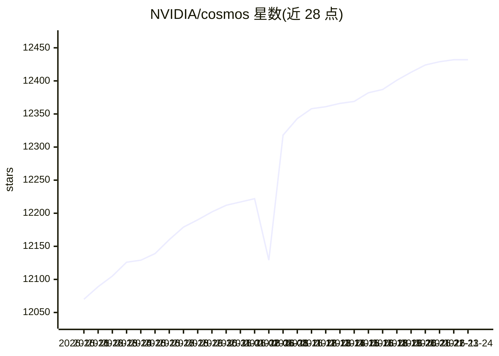

# NVIDIA/cosmos

⭐ 12,432 · NOASSERTION · 推送 2026-11-19 · [GitHub](https://github.com/NVIDIA/cosmos) · [官网](https://www.nvidia.com/en-us/ai/cosmos/) · 组织维护

**面向机器人和自动驾驶开发者的世界模型与数据平台**

NVIDIA Cosmos 是构建物理 AI 应用的开放平台，覆盖机器人、自动驾驶、智能基础设施等行业。核心是 Cosmos 3 全模态世界模型家族（Reasoner 做理解与规划，Generator 做仿真、合成数据与策略学习），分 Super 64B、Nano 16B、Edge 4B 三档。平台配套 Cosmos Framework（SFT/LoRA/RL/蒸馏训练）、Curator（数据整理）、Evaluator（输出评估）与 cookbook 示例仓库；本仓库为入口，提供 Quickstart 与 agent 可运行 recipes。使用需申请 Guardrail 仓库访问权限。

## 筛选速览

| 维度 | 判定 | 备注 |
|---|---|---|
| AI 角色 | `ai-native` | 本体是模型或模型工具 |
| 许可风险 | `none` | NOASSERTION |
| 部署形态 | `library` | 以包/库形式分发 |
| 模型依赖 | local-ok | 支持本地模型 |
| 硬件要求 | — | 无带数字的原话,不猜 |
| 安装摩擦 | `medium` | 含编译或系统依赖之一 |
| 成熟度 | — | 结构信号不足 |

## 能力要点

- Cosmos 3 全模态世界模型：Reasoner（文本输出）与 Generator（视觉/音频/动作输出）双塔架构
- 三档基座模型按部署规模划分：64B/H200 级、16B/RTX Pro 6000 级、4B/Jetson 边缘级
- 配套训练（SFT/LoRA/蒸馏/RL）、数据整理与自动评估三个平台组件
- 生成默认开启 guardrail，需申请 Hugging Face gated 仓库访问

## 适用场景

- 为自动驾驶生成合成数据与闭环仿真
- 生成机器人操作策略并在边缘设备实时运行
- 后训练定制自己的世界模型
- 对真实场景做预测与具身推理

## 场景标签

`微调` `视频生成` · 领域:内容生成

## 证据(README 行号)

> L37: NVIDIA Cosmos is an open platform for building physical AI applications, supporting industry verticals such as robo
> L46: |**Generator**|text, vision, audio, action|vision, audio, action|world simulation, future prediction, synthetic dat
> L92: |Cosmos3-Super|64B|H200 / B200 / GB200|Highest quality; synthetic data generation; teacher for distillation|

## 星数曲线

2026-10-21 12,070 → 2026-11-24 12,432（+362）

---
*卡片 v1 · prompt 1.4 · 生成 2026-11-22 · 置信度 high · 依据 README sha `a83bbc08ea3e` · [字段定义](../../DATASET.md)*
