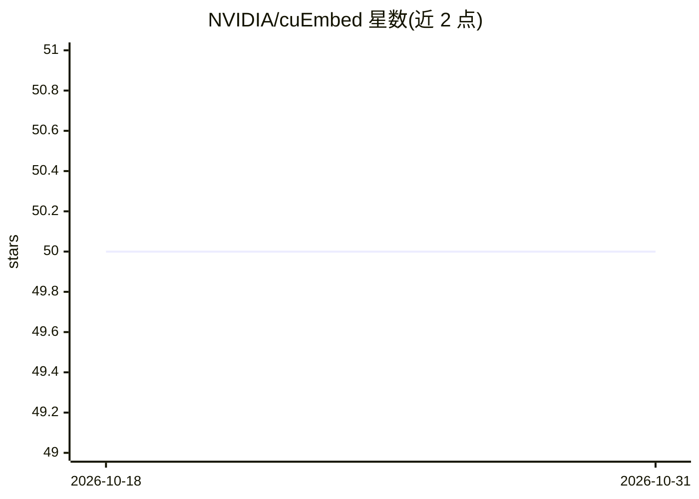

# NVIDIA/cuEmbed

⭐ 50 · Cuda · Apache-2.0 · 推送 2026-10-09 · [GitHub](https://github.com/NVIDIA/cuEmbed) · 组织维护

**NVIDIA 的 header-only CUDA embedding lookup 内核库，加速嵌入查表**

cuEmbed 是 NVIDIA 开源的头文件式 CUDA C++ 内核库，用于加速深度学习中的 embedding lookup：支持前向传播（fixed-hotness/CSR）、反向传播（COO、全量或压缩梯度）与索引转置。通过少量面向内存级并行的内核与 C++ 模板编译期特化覆盖多种查表配置，目标是在访问嵌入行时最大化在飞加载以提升显存带宽利用率。面向在 CUDA 程序中做嵌入查表的开发者，以 CMake/CPM 方式集成。项目仍在开发中，内核 API 可能变化；当前仅支持单表单 GPU，要求 nvcc 12.0+、C++17、Ampere 及以上架构。

## 筛选速览

| 维度 | 判定 | 备注 |
|---|---|---|
| AI 角色 | `ai-ecosystem` | LLM/agent 周边工具 |
| 许可风险 | `permissive` | Apache-2.0 |
| 部署形态 | `None` |  |
| 模型依赖 | — | README 未给出锁定关系 |
| 硬件要求 | — | 无带数字的原话,不猜 |
| 安装摩擦 | `high` | 编译与系统依赖俱全 |
| 成熟度 | `idea` | |

## 能力要点

- header-only 设计，头文件可复制进独立库，依赖极少
- 前向/反向/索引转置内核，面向内存级并行优化
- 支持 fp32/fp16、int32/int64 索引、weighted sum/concat/mean 归约
- 自带测试与基准测试（sweep_parameters.sh、manual_benchmark）

## 适用场景

- 在自研 CUDA 推理/训练程序中集成高性能 embedding lookup
- 对查表内核做参数扫描基准测试
- 构建推荐系统等嵌入密集负载的 GPU 内核组件

## 场景标签

 · 领域:GPU 内核库/深度学习基础设施

## 证据(README 行号)

> L4: cuEmbed is an open-source, header-only CUDA kernel library that accelerates embedding lookup. It aims to achieve hig
> L16: Core components of cuEmbed are the kernel headers in the `cuembed/include` directory. These files have minimal depe

## 星数曲线

2026-10-18 50 → 2026-10-31 50（+0）

---
*卡片 v1 · prompt 1.4 · 生成 2026-10-24 · 置信度 high · 依据 README sha `0f2f68b6c1b8` · [字段定义](../../DATASET.md)*
