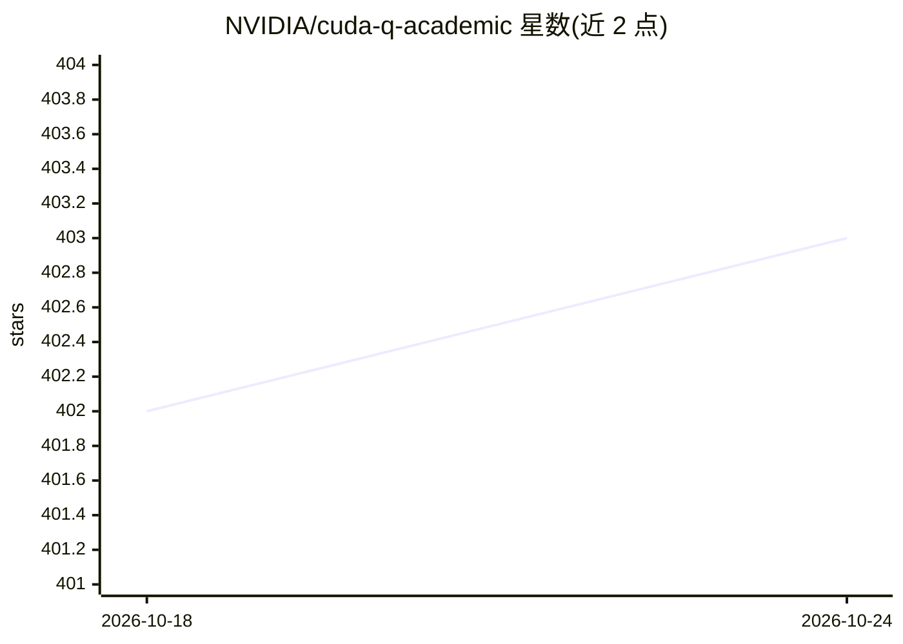

# NVIDIA/cuda-q-academic

⭐ 403 · Jupyter Notebook · NOASSERTION · 推送 2026-10-21 · [GitHub](https://github.com/NVIDIA/cuda-q-academic) · 组织维护

**面向高校量子计算课程的 CUDA-Q 交互式教学模块合集**

NVIDIA 与高校合作开发的开源教学资源库，基于 CUDA-Q 混合经典-量子计算平台，提供从量子计算入门、量子纠错、算法仿真、化学模拟到 AI for Quantum 等模块的自定进度 Jupyter Notebook，并配套可视化小组件画廊、课程目录（curriculum.json）与教师指南。另含基于 agentic AI 的四人角色量子-GPU 团队项目模板，学生配置 AI 编码代理（Claude Code、Cursor、Windsurf 等）完成实现。运行途径包括 NVIDIA Brev 云实例、qBraid、Amazon Braket、Google Colab 与本地安装。材料以 Apache-2.0 与 CC-BY-NC-4.0 供教育用途使用。

## 筛选速览

| 维度 | 判定 | 备注 |
|---|---|---|
| AI 角色 | `ai-knowledge` | 知识聚合/清单类 |
| 许可风险 | `none` | NOASSERTION |
| 部署形态 | `None` |  |
| 模型依赖 | — | README 未给出锁定关系 |
| 硬件要求 | — | 无带数字的原话,不猜 |
| 安装摩擦 | `medium` | 含编译或系统依赖之一 |
| 成熟度 | — | 结构信号不足 |

## 能力要点

- 十余个自定进度教学模块覆盖入门、QEC、仿真、化学、金融、AI for Quantum 等
- 四人角色、四里程碑的 agentic AI 量子-GPU 团队项目模板
- 交互式可视化小组件与机器可读课程目录 curriculum.json
- 支持 Brev/qBraid/Braket/Colab/本地多种运行入口

## 适用场景

- 高校量子计算课程寻找配套动手实验材料
- 学生按学习路径自学 CUDA-Q 混合量子-经典编程
- 教师组织基于 AI 代理的量子计算团队项目

## 场景标签

`教程课程` · 领域:学习与行业

## 证据(README 行号)

> L11: NVIDIA's CUDA-Q Academic is a freely available, open-source collection of interactive educational resources that pr
> L32: The repository is organized into the learning path modules below. For machine-readable lesson and widget discovery,

## 星数曲线

2026-10-18 402 → 2026-10-24 403（+1）

---
*卡片 v1 · prompt 1.4 · 生成 2026-10-21 · 置信度 high · 依据 README sha `d44e8b1e1c5a` · [字段定义](../../DATASET.md)*
