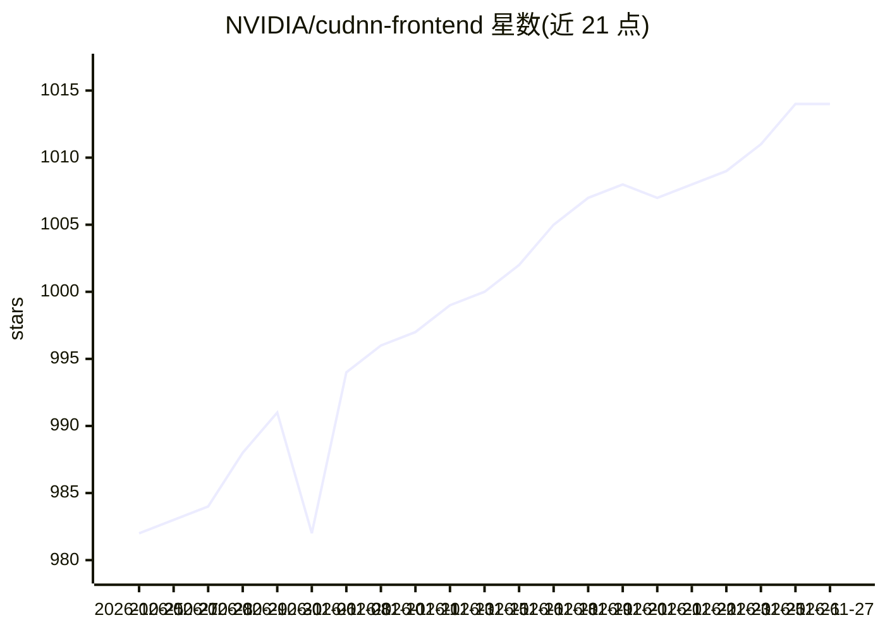

# NVIDIA/cudnn-frontend

⭐ 1,014 · Cuda · Apache-2.0 · 推送 2026-11-26 · [GitHub](https://github.com/NVIDIA/cudnn-frontend) · [官网](https://docs.nvidia.com/deeplearning/cudnn/latest/) · 组织维护

**cuDNN 库的 C++/Python 前端接口与开源 GPU 内核集合**

提供 header-only C++ API 与 Python 接口（含 PyTorch 集成）访问 cuDNN Graph API，面向 Hopper/Blackwell GPU，支持 FP16/BF16/FP8/MXFP8 精度。核心机制是统一 Graph API：以图描述子计算（SDPA/Flash Attention、Grouped GEMM/MoE 融合、归一化+激活融合等），内置自动调优并按测速对后端与开源 FROST 引擎排序。另开源一批 CuTe DSL 内核（Flex Attention、NSA、线性注意力等），可通过环境变量选择引擎。限制：需 NVIDIA GPU、驱动、CUDA Toolkit 与 cuDNN 8.5+。

## 筛选速览

| 维度 | 判定 | 备注 |
|---|---|---|
| AI 角色 | `ai-native` | 本体是模型或模型工具 |
| 许可风险 | `permissive` | Apache-2.0 |
| 部署形态 | `library` | 以包/库形式分发 |
| 模型依赖 | — | README 未给出锁定关系 |
| 硬件要求 | — | 无带数字的原话,不猜 |
| 安装摩擦 | `high` | 编译与系统依赖俱全 |
| 成熟度 | — | 结构信号不足 |

## 能力要点

- header-only C++ API 与带 PyTorch 集成的 Python 接口
- 统一 Graph API 描述子计算并内置自动调优
- 开源 SDPA、Grouped GEMM+SwiGLU、NSA 等 CuTe DSL 内核
- 支持 FP16/BF16/FP8/MXFP8 精度与 CUDA graph 集成

## 适用场景

- 为 PyTorch/自研框架接入 cuDNN 的注意力与 GEMM 内核
- MoE 训练中的 Grouped GEMM 融合计算
- 检查、修改并贡献开源 GPU 注意力内核

## 场景标签

 · 领域:深度学习/GPU 计算库

## 证据(README 行号)

> L9: **cuDNN Frontend** is NVIDIA's modern, open-source entry point to the cuDNN library and a growing collection of high
> L11: It provides a **header-only C++ API** and a **Python interface** (with native PyTorch integration) to the cuDNN Gra
> L89: * **Unified Graph API:** Create reusable, persistent `cudnn_frontend::graph::Graph` objects to describe complex sub

## 星数曲线

2026-10-25 982 → 2026-11-27 1,014（+32）

---
*卡片 v1 · prompt 1.4 · 生成 2026-11-24 · 置信度 high · 依据 README sha `fa5a0a36f9a3` · [字段定义](../../DATASET.md)*
