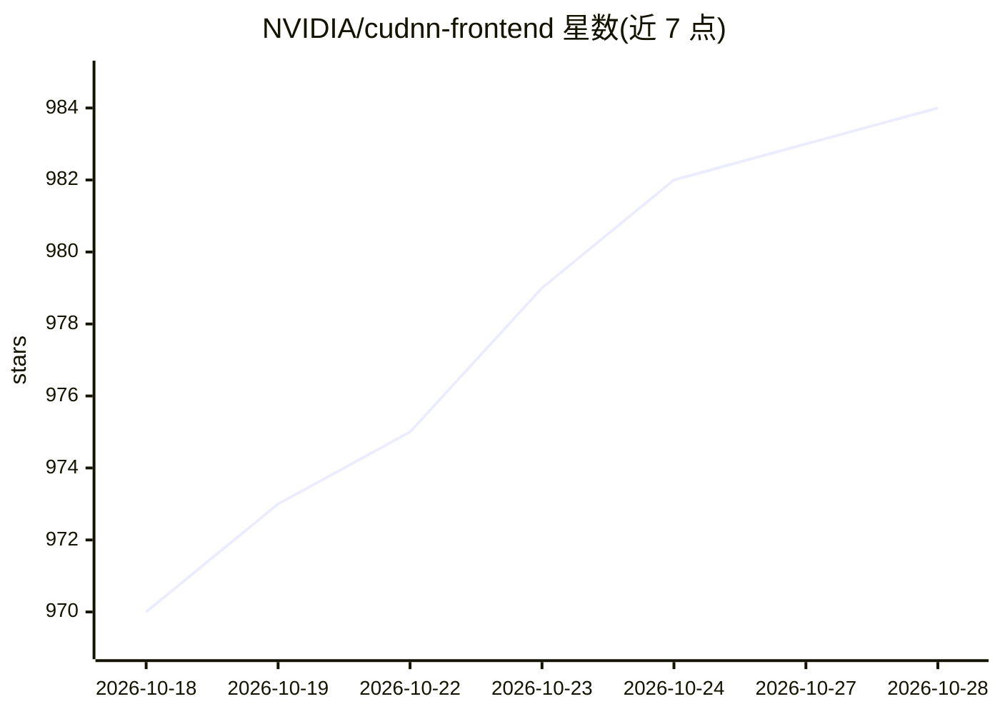

# NVIDIA/cudnn-frontend

⭐ 988 · Python · Apache-2.0 · 推送 2026-10-28 · [GitHub](https://github.com/NVIDIA/cudnn-frontend) · [官网](https://docs.nvidia.com/deeplearning/cudnn/latest/) · 组织维护

**cuDNN 的开源 C++/Python 前端与高性能 GPU 内核集合**

NVIDIA 维护的 cuDNN 库入口层：提供 header-only C++ API 与 Python 绑定（含 PyTorch 原生集成），面向 cuDNN Graph API 构建可复用计算子图；目标硬件为 Hopper（H100/H200）与 Blackwell（B200/GB200/GB300）GPU，支持 FP16/BF16/FP8/MXFP8 精度。另开源不断扩充的内核集合：SDPA/Flash Attention、面向 MoE 训练的 grouped GEMM 融合（SwiGLU/GLU/Quant 等）、Flex Attention、线性注意力（GDN/KDA/Mamba-2）与 FROST JIT GEMM 引擎。Python 包经 pip 安装，运行需 NVIDIA 驱动、CUDA Toolkit 与 cuDNN（≥8.5.0）。

## 筛选速览

| 维度 | 判定 | 备注 |
|---|---|---|
| AI 角色 | `ai-ecosystem` | LLM/agent 周边工具 |
| 许可风险 | `permissive` | Apache-2.0 |
| 部署形态 | `library` | 以包/库形式分发 |
| 模型依赖 | — | README 未给出锁定关系 |
| 硬件要求 | — | 无带数字的原话,不猜 |
| 安装摩擦 | `high` | 编译与系统依赖俱全 |
| 成熟度 | — | 结构信号不足 |

## 能力要点

- header-only C++ API 与 Python 绑定封装 cuDNN Graph API
- 面向 Hopper/Blackwell GPU 的 FP16/BF16/FP8/MXFP8 支持
- 开源内核集合：SDPA、MoE grouped GEMM 融合、Flex Attention、线性注意力等
- FROST JIT 编译 GEMM 引擎，通过环境变量启用并与后端计划排序竞争

## 适用场景

- 在 PyTorch 或 C++ 中直接调用 cuDNN 注意力与 GEMM 融合内核
- MoE 训练场景下使用 grouped GEMM 融合内核
- 查看、修改并贡献 GPU 内核源码以满足定制需求

## 场景标签

 · 领域:深度学习/GPU 计算基础设施

## 证据(README 行号)

> L9: **cuDNN Frontend** is NVIDIA's modern, open-source entry point to the cuDNN library and a growing collection of high
> L11: It provides a **header-only C++ API** and a **Python interface** (with native PyTorch integration) to the cuDNN Gra
> L89: * **Unified Graph API:** Create reusable, persistent `cudnn_frontend::graph::Graph` objects to describe complex sub

## 星数曲线

2026-10-18 970 → 2026-10-28 984（+14）

---
*卡片 v1 · prompt 1.4 · 生成 2026-10-21 · 置信度 high · 依据 README sha `78c3433136da` · [字段定义](../../DATASET.md)*
