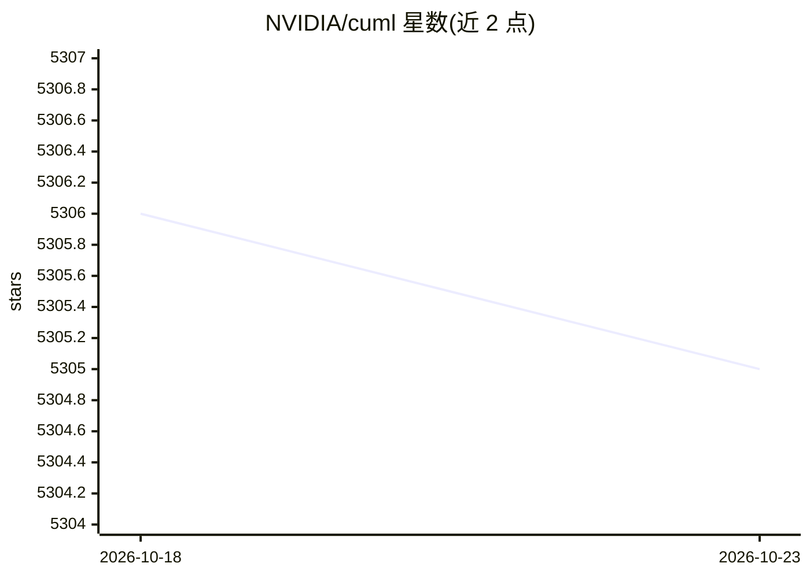

# NVIDIA/cuml

⭐ 5,305 · Python · Apache-2.0 · 推送 2026-10-22 · [GitHub](https://github.com/NVIDIA/cuml) · [官网](https://docs.nvidia.com/cuml/) · 组织维护

**面向 NVIDIA GPU 的机器学习加速库，兼容 scikit-learn 工作流**

NVIDIA 开源的 CUDA-X 数据科学库，提供两种在 GPU 上运行机器学习负载的方式：一是 cuml Python API，GPU 原生估计器，遵循 scikit-learn 的 fit-predict-transform 模式，覆盖聚类、降维、回归、分类、预处理、模型选择、模型解释与近邻搜索；二是 cuml.accel，在不修改代码的情况下加速现有 scikit-learn、UMAP、HDBSCAN 代码，不支持的操作自动回退 CPU 实现。另提供 cuml.dask 支持多 GPU 与多节点分布式执行，模型可用 pickle/joblib 序列化。依赖 NVIDIA GPU 与 CUDA，面向数据科学与机器学习开发者。

## 筛选速览

| 维度 | 判定 | 备注 |
|---|---|---|
| AI 角色 | `ai-native` | 本体是模型或模型工具 |
| 许可风险 | `permissive` | Apache-2.0 |
| 部署形态 | `None` |  |
| 模型依赖 | — | README 未给出锁定关系 |
| 硬件要求 | — | 无带数字的原话,不猜 |
| 安装摩擦 | `medium` | 含编译或系统依赖之一 |
| 成熟度 | — | 结构信号不足 |

## 能力要点

- GPU 原生估计器，scikit-learn 风格 API（fit-predict-transform）
- cuml.accel 零代码改动加速 scikit-learn/UMAP/HDBSCAN，不支持时回退 CPU
- cuml.dask 提供多 GPU 与多节点分布式算法实现
- 模型可用 pickle/joblib 序列化，cuml.accel 训练的模型可用 scikit-learn 加载

## 适用场景

- 把现有 scikit-learn 脚本不改代码迁移到 GPU 加速
- 在多 GPU/多节点集群上分布式运行机器学习算法
- 在 GPU 上直接编写聚类、降维、回归等机器学习工作流

## 场景标签

 · 领域:机器学习/GPU 加速计算

## 证据(README 行号)

> L3: NVIDIA cuML is an open-source CUDA-X Data Science library for
> L4: GPU-accelerated machine learning. It provides two ways to run machine learning
> L7: - The `cuml` Python API provides GPU-native estimators with familiar
> L9: - `cuml.accel` accelerates existing scikit-learn, UMAP, and HDBSCAN code without

## 星数曲线

2026-10-18 5,306 → 2026-10-23 5,305（-1）

---
*卡片 v1 · prompt 1.4 · 生成 2026-10-20 · 置信度 high · 依据 README sha `8fea3d28b652` · [字段定义](../../DATASET.md)*
