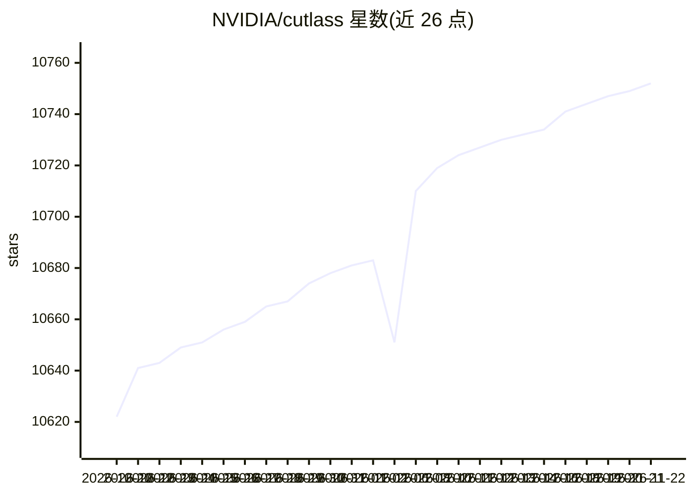

# NVIDIA/cutlass

⭐ 10,752 · C++ · NOASSERTION · 推送 2026-11-20 · [GitHub](https://github.com/NVIDIA/cutlass) · [官网](https://docs.nvidia.com/cutlass/index.html) · 组织维护

**给 CUDA 开发者的高性能 GEMM/线性代数模板库与 Python DSL**

CUTLASS 提供 CUDA 上实现高性能矩阵乘（GEMM）及相关计算的抽象集合，将层级分解与数据搬运策略拆解为可复用的模块化组件，可通过 tiling 尺寸、数据类型与算法策略定制。支持 FP64 到 FP4 等多种精度类型，覆盖 Volta 至 Blackwell 架构。4.x 版本新增 CuTe DSL：Python 原生接口编写 CUDA 内核，宣称缩短编译时间并可原生接入 DL 框架。面向学生、研究者与性能工程师，用于内核设计与生产化。

## 筛选速览

| 维度 | 判定 | 备注 |
|---|---|---|
| AI 角色 | `ai-ecosystem` | LLM/agent 周边工具 |
| 许可风险 | `none` | NOASSERTION |
| 部署形态 | `library` | 以包/库形式分发 |
| 模型依赖 | — | README 未给出锁定关系 |
| 硬件要求 | — | 无带数字的原话,不猜 |
| 安装摩擦 | `high` | 编译与系统依赖俱全 |
| 成熟度 | `idea` | |

## 能力要点

- CUDA C++ 模板抽象与 CuTe Python DSL 双接口，支持自定义 tiling、数据类型与算法策略
- 支持 FP64/TF32/FP16/BF16/FP8/NVFP4/MXFP4 等多种数据类型
- 覆盖 Volta、Turing、Ampere、Ada、Hopper、Blackwell 与 Rubin 架构
- 提供 Epilogue Fusion、TMA 加载、2:4 结构化稀疏等内核原语

## 适用场景

- 为深度学习框架编写和优化自定义 GEMM/卷积 CUDA 内核
- 用 CuTe DSL 快速原型化内核设计而无需深入 C++ 模板编程
- 针对新 NVIDIA 架构（Hopper/Blackwell/Rubin）做性能工程与调优

## 场景标签

 · 领域:GPU 计算/深度学习基础设施

## 证据(README 行号)

> L8: CUTLASS is a collection of abstractions for implementing high-performance matrix-matrix multiplication (GEMM)
> L28: To this rich ecosystem of C++ based kernel programming abstractions, CUTLASS 4 adds CUTLASS DSLs. These are Python 
> L36: We believe it will become an indispensable tool for students, researchers, and performance

## 星数曲线

2026-10-20 10,622 → 2026-11-22 10,752（+130）

---
*卡片 v1 · prompt 1.4 · 生成 2026-11-22 · 置信度 high · 依据 README sha `8bdd9cb0fe78` · [字段定义](../../DATASET.md)*
