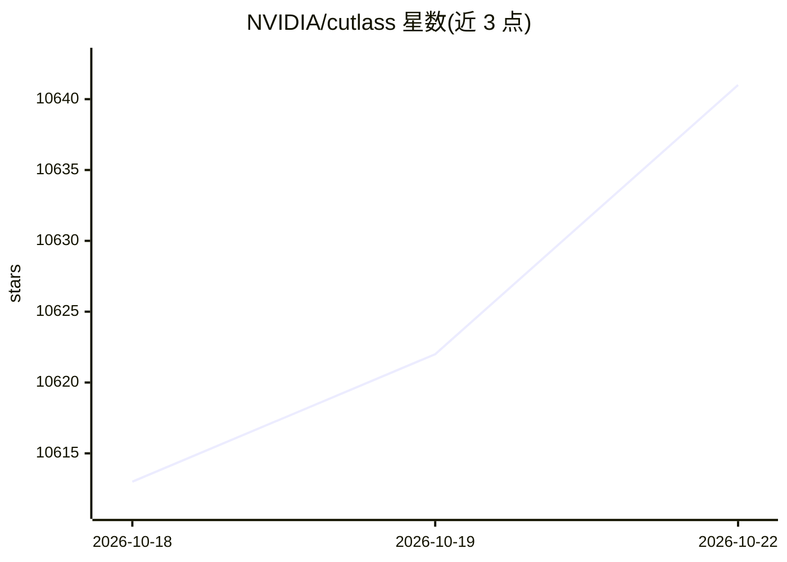

# NVIDIA/cutlass

⭐ 10,641 · C++ · NOASSERTION · 推送 2026-10-21 · [GitHub](https://github.com/NVIDIA/cutlass) · [官网](https://docs.nvidia.com/cutlass/index.html) · 组织维护

**CUDA C++ 模板与 Python DSL 库：构建高性能 GEMM 等线性代数内核**

NVIDIA 维护的高性能矩阵乘（GEMM）及相关计算的实现集合：以 CUDA C++ 模板抽象提供分层分解与数据移动组件，覆盖 FP64/FP32/TF32/FP16/BF16/FP8/FP4、块缩放与窄整数等数据类型，支持 Volta 到 Blackwell 及 Rubin（SM107）架构。CUTLASS 4 起加入 CuTe DSL——用 Python 编写 CUDA 内核的接口，含 Operator API、原语库与 IKET 性能分析工具。面向内核开发者、科研与性能工程人员，用于深度学习框架底层内核构建；CuTe DSL 处于公开 beta 阶段。

## 筛选速览

| 维度 | 判定 | 备注 |
|---|---|---|
| AI 角色 | `ai-ecosystem` | LLM/agent 周边工具 |
| 许可风险 | `none` | NOASSERTION |
| 部署形态 | `None` |  |
| 模型依赖 | — | README 未给出锁定关系 |
| 硬件要求 | — | 无带数字的原话,不猜 |
| 安装摩擦 | `high` | 编译与系统依赖俱全 |
| 成熟度 | `idea` | |

## 能力要点

- CUDA C++ 模板抽象覆盖多种精度数据类型与多代 NVIDIA 架构
- CuTe DSL：基于 Python 编写 CUDA 内核，无需 C++ 深度 expertise
- Operator API 暴露独立内核并支持性能预估排序
- 4.8 加入初步 Rubin（SM107）支持与大量 Blackwell/Ampere 示例

## 适用场景

- 为深度学习框架或自定义应用编写高性能 GEMM/卷积内核
- 用 Python 快速原型化 CUDA 内核设计并投入生产
- 针对特定架构与数据类型调优矩阵乘性能

## 场景标签

 · 领域:GPU 计算/深度学习基础设施

## 证据(README 行号)

> L8: CUTLASS is a collection of abstractions for implementing high-performance matrix-matrix multiplication (GEMM)
> L28: To this rich ecosystem of C++ based kernel programming abstractions, CUTLASS 4 adds CUTLASS DSLs. These are Python 

## 星数曲线

2026-10-18 10,613 → 2026-10-22 10,641（+28）

---
*卡片 v1 · prompt 1.4 · 生成 2026-10-20 · 置信度 high · 依据 README sha `0eca95758390` · [字段定义](../../DATASET.md)*
