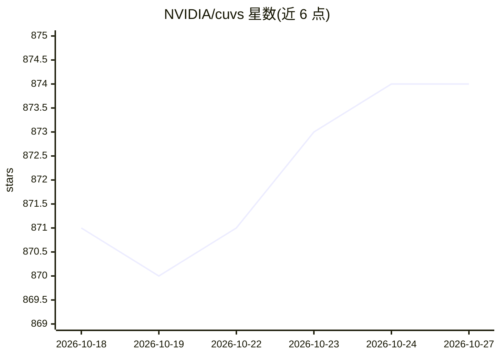

# NVIDIA/cuvs

⭐ 874 · Cuda · Apache-2.0 · 推送 2026-10-26 · [GitHub](https://github.com/NVIDIA/cuvs) · [官网](https://docs.nvidia.com/cuvs/) · 组织维护

**面向开发者的 GPU 向量搜索与聚类库（C++/Python/C/Rust）**

NVIDIA 维护的 GPU 加速库，提供近似最近邻搜索（如 CAGRA、IVF-RaBitQ）与聚类等算法实现，构建于 RAFT 与底层 CUDA 库之上。支持 Python、C++、C、Rust 多语言 API，可通过 conda、pip 或 tarball 安装预构建包，也可从源码构建或用 Docker 构建独立 C 库。可直接使用或经集成它的数据库/库间接使用；特性包括 GPU 构建/CPU 部署互操作、延迟敏感与高吞吐搜索。运行依赖 CUDA 与 NVIDIA GPU 架构。

## 筛选速览

| 维度 | 判定 | 备注 |
|---|---|---|
| AI 角色 | `ai-ecosystem` | LLM/agent 周边工具 |
| 许可风险 | `permissive` | Apache-2.0 |
| 部署形态 | `None` |  |
| 模型依赖 | — | README 未给出锁定关系 |
| 硬件要求 | — | 无带数字的原话,不猜 |
| 安装摩擦 | `high` | 编译与系统依赖俱全 |
| 成熟度 | — | 结构信号不足 |

## 能力要点

- GPU 上的 ANN 搜索与聚类算法（CAGRA 等，多篇论文支撑）
- Python/C++/C/Rust 多语言 API
- conda/pip/tarball 预构建包与 Docker 构建独立 C 库
- 基于 RAFT，随新 CUDA 版本与 NVIDIA 架构更新

## 适用场景

- 为 RAG 或语义搜索构建 GPU 向量索引
- 加速聚类与 k-NN 图构建等数据挖掘任务
- 在 C/C++ 项目中嵌入独立向量搜索 C 库

## 场景标签

`语义搜索` `向量数据库` · 领域:知识与检索

## 证据(README 行号)

> L17: cuVS contains state-of-the-art implementations of several algorithms for running approximate nearest neighbors and 
> L61: cuVS is built on top of the NVIDIA RAFT library of high performance machine learning primitives and provides all th

## 星数曲线

2026-10-18 871 → 2026-10-27 874（+3）

---
*卡片 v1 · prompt 1.4 · 生成 2026-10-21 · 置信度 high · 依据 README sha `801095686f0a` · [字段定义](../../DATASET.md)*
