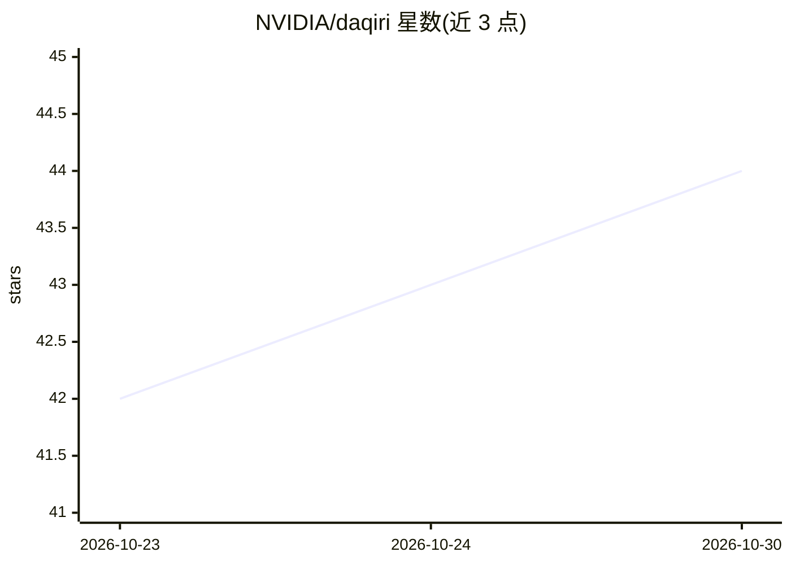

# NVIDIA/daqiri

⭐ 44 · C++ · Apache-2.0 · 推送 2026-10-29 · [GitHub](https://github.com/NVIDIA/daqiri) · [官网](https://www.holoscan.org/daqiri/) · 组织维护

**面向科学仪器的高速以太网数据采集库：直连 GPU 做实时处理**

NVIDIA 开源的 C++/Python 数据采集库：在用户态直接访问 NIC 硬件、绕过 Linux 内核网络栈，以每 GPU 数百 Gbps 收发以太网包到 CPU 与 GPU 内存，支持 GPUDirect 零拷贝、RDMA/RoCE、DPDK 与 raw ibverbs 引擎、硬件流引导、多区域收包与运行时动态队列管理。面向构建实时 AI 数据处理管线的科学与工业仪器开发者，属 Holoscan 平台组件。峰值性能需 ConnectX-6 Dx 及以上 SmartNIC 与 GPUDirect GPU；任意 NIC 可走内置 Linux Sockets 引擎。提供可选 TensorRT ResNet-50 推理示例应用。

## 筛选速览

| 维度 | 判定 | 备注 |
|---|---|---|
| AI 角色 | `ai-ecosystem` | LLM/agent 周边工具 |
| 许可风险 | `permissive` | Apache-2.0 |
| 部署形态 | `None` |  |
| 模型依赖 | — | README 未给出锁定关系 |
| 硬件要求 | — | 无带数字的原话,不猜 |
| 安装摩擦 | `high` | 编译与系统依赖俱全 |
| 成熟度 | — | 结构信号不足 |

## 能力要点

- 用户态 NIC 直访绕过内核网络栈，GPUDirect 零拷贝到 GPU 内存
- 支持 RDMA/RoCE、raw DPDK、raw ibverbs 与 Linux sockets 多引擎
- 硬件流引导、运行时动态队列/内存区/命名端点管理
- 可选 TensorRT ResNet-50 推理示例与 Holoscan SDK 集成教程

## 适用场景

- 科学仪器高速传感数据流实时送入 GPU 处理
- 构建低延迟线速以太网收发与基准测试
- GPUDirect 零拷贝数据通路下的实时 AI 管线开发

## 场景标签

 · 领域:高性能网络/实时数据采集

## 证据(README 行号)

> L7: DAQIRI (Data Acquisition for Integrated Real-time Instruments) connects data acquisition systems to NVIDIA GPUs for 
> L39: - **AI/ML integration** — Optional `daqiri_resnet50_inference` application
> L113: - DAQIRI + Holoscan SDK (HSDK) Integration — use DAQIRI RX bursts from an HSDK source operator

## 星数曲线

2026-10-23 42 → 2026-10-30 44（+2）

---
*卡片 v1 · prompt 1.4 · 生成 2026-10-25 · 置信度 high · 依据 README sha `2c3bb6e82ccc` · [字段定义](../../DATASET.md)*
