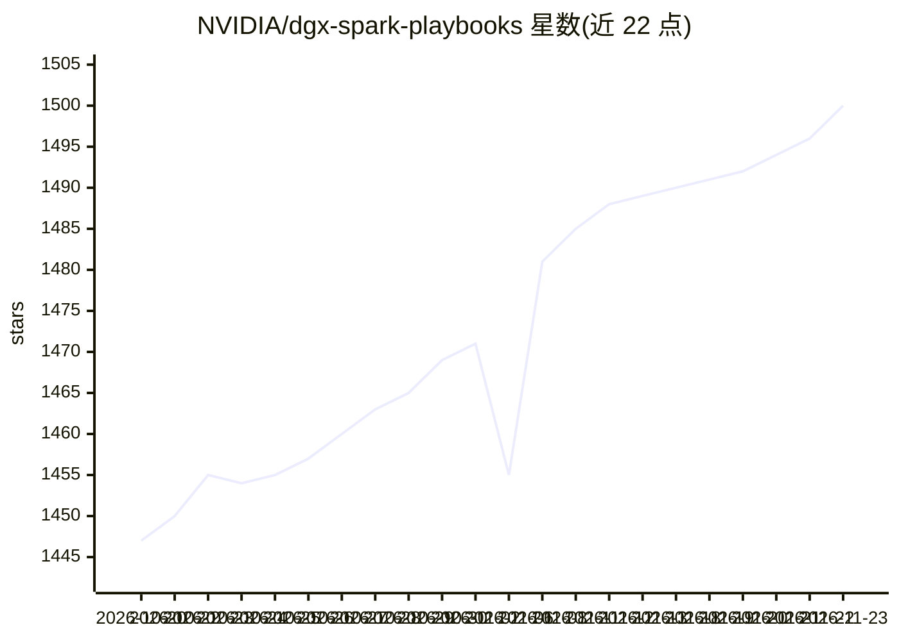

# NVIDIA/dgx-spark-playbooks

⭐ 1,500 · Jupyter Notebook · Apache-2.0 · 推送 2026-10-23 · [GitHub](https://github.com/NVIDIA/dgx-spark-playbooks) · 组织维护

**DGX Spark 设备上搭建 AI/ML 工作负载的步骤式指南合集**

NVIDIA 官方维护的 playbook 合集，面向使用 Blackwell 架构 DGX Spark 设备的用户，提供部署 AI/ML 工作负载的分步说明。内容涵盖安装配置 AI 框架、运行优化模型推理、搭建开发环境、设备连接与管理，以及多机分布式部署、模型微调、本地 LLM 服务等约 70 个指南条目。每个 playbook 包含前置条件、步骤说明、故障排查与示例代码；README 本身是目录，未包含具体安装命令。

## 筛选速览

| 维度 | 判定 | 备注 |
|---|---|---|
| AI 角色 | `ai-knowledge` | 知识聚合/清单类 |
| 许可风险 | `permissive` | Apache-2.0 |
| 部署形态 | `None` |  |
| 模型依赖 | — | README 未给出锁定关系 |
| 硬件要求 | — | 无带数字的原话,不猜 |
| 安装摩擦 | `medium` | 含编译或系统依赖之一 |
| 成熟度 | — | 结构信号不足 |

## 能力要点

- 约 70 个覆盖推理、微调、多机分布式、开发环境配置的 playbook 目录
- 每个 playbook 含前置条件、分步说明、故障排查与示例代码
- 覆盖本地 LLM 服务（llama.cpp/Ollama/LM Studio/vLLM/SGLang 等）与 Agent 搭建指南
- 附 NVIDIA 官方文档与开发者论坛链接

## 适用场景

- 拿到 DGX Spark 后按步骤配置 AI 框架与开发环境
- 在 DGX Spark 上部署本地 LLM 推理服务
- 连接多台 DGX Spark 搭建分布式工作负载
- 参考官方指南微调专用 LLM 与图像生成模型

## 场景标签

`教程课程` `微调` · 领域:学习与行业

## 证据(README 行号)

> L5: Collection of step-by-step playbooks for setting up AI/ML workloads on NVIDIA DGX Spark devices with Blackwell archi
> L9: These playbooks provide detailed instructions for:
> L17: ## Available Playbooks

## 星数曲线

2026-10-20 1,447 → 2026-11-23 1,500（+53）

---
*卡片 v1 · prompt 1.4 · 生成 2026-11-23 · 置信度 high · 依据 README sha `a86d91250391` · [字段定义](../../DATASET.md)*
