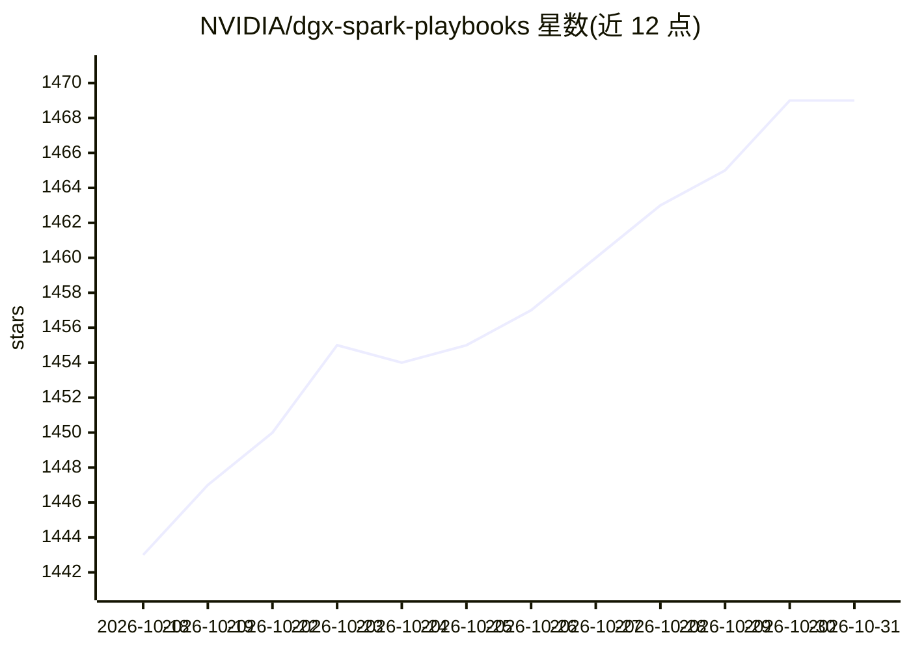

# NVIDIA/dgx-spark-playbooks

⭐ 1,469 · Jupyter Notebook · Apache-2.0 · 推送 2026-10-23 · [GitHub](https://github.com/NVIDIA/dgx-spark-playbooks) · 组织维护

**NVIDIA DGX Spark 设备上部署 AI/ML 工作流的操作手册集**

NVIDIA 维护的分步操作手册（playbooks）集合，面向 DGX Spark（Blackwell 架构 GB10）设备用户，覆盖 AI 框架安装配置、本地 LLM 推理与微调（llama.cpp/vLLM/SGLang/TensorRT-LLM）、多机互联与分布式工作负载、ComfyUI 图像视频生成、RAG 与 agent 应用搭建等主题。每份手册包含前置条件、分步说明、故障排查与示例代码。仓库本身为文档集合，不含可安装的软件。

## 筛选速览

| 维度 | 判定 | 备注 |
|---|---|---|
| AI 角色 | `ai-knowledge` | 知识聚合/清单类 |
| 许可风险 | `permissive` | Apache-2.0 |
| 部署形态 | `None` |  |
| 模型依赖 | — | README 未给出锁定关系 |
| 硬件要求 | — | 无带数字的原话,不猜 |
| 安装摩擦 | `medium` | 含编译或系统依赖之一 |
| 成熟度 | — | 结构信号不足 |

## 能力要点

- 70+ 篇覆盖推理、微调、分布式、agent 应用等主题的操作手册
- 含多台 DGX Spark 互联（ring 拓扑、交换机、NCCL）的组网手册
- 每篇手册附前置条件、步骤、故障排查与示例代码

## 适用场景

- 按手册在 DGX Spark 上部署本地 LLM 推理或微调环境
- 组建多台 DGX Spark 的分布式训练/推理集群
- 查找 ComfyUI、RAG、机器人仿真等具体工作负载的搭建步骤

## 场景标签

`教程课程` · 领域:学习与行业

## 证据(README 行号)

> L5: Collection of step-by-step playbooks for setting up AI/ML workloads on NVIDIA DGX Spark devices with Blackwell archi
> L15: Each playbook includes prerequisites, step-by-step instructions, troubleshooting guidance, and example code.

## 星数曲线

2026-10-18 1,443 → 2026-10-31 1,469（+26）

---
*卡片 v1 · prompt 1.4 · 生成 2026-10-21 · 置信度 high · 依据 README sha `1447c3290951` · [字段定义](../../DATASET.md)*
