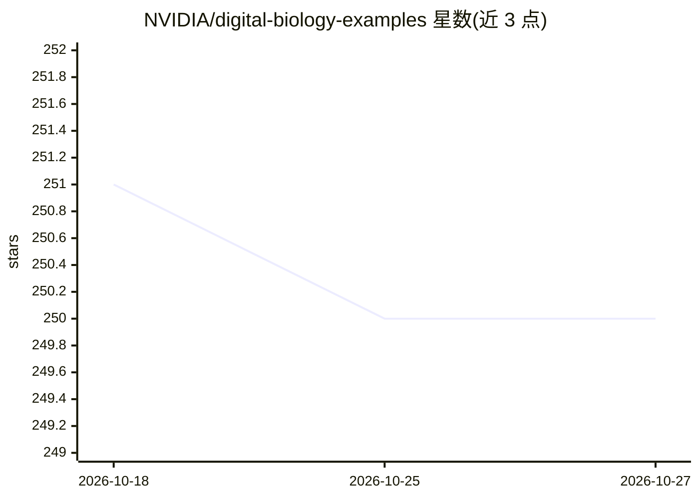

# NVIDIA/digital-biology-examples

⭐ 250 · 推送 2026-09-24 · [GitHub](https://github.com/NVIDIA/digital-biology-examples) · 组织维护

**NVIDIA 数字生物学与药物发现示例集合：蛋白折叠到虚拟筛选**

NVIDIA 维护的数字生物学与计算药物发现示例仓库，覆盖 AI 蛋白质折叠、分子生成、基于结构的药物设计、虚拟筛选等方向。示例围绕 BioNeMo 平台与 NIM 微服务（预构建容器，可本地或云端部署）及 NIM Blueprints 展开，展示如何用 NVIDIA 加速计算平台构建生物学研究与制药开发工作流。README 声明示例仅供教育与演示用途，按现状提供、不含维护与支持。

## 筛选速览

| 维度 | 判定 | 备注 |
|---|---|---|
| AI 角色 | `ai-knowledge` | 知识聚合/清单类 |
| 许可风险 | `none` | — |
| 部署形态 | `None` |  |
| 模型依赖 | — | README 未给出锁定关系 |
| 硬件要求 | — | 无带数字的原话,不猜 |
| 安装摩擦 | `low` | 无编译、无系统依赖或容器化 |
| 成熟度 | — | 结构信号不足 |

## 能力要点

- 示例覆盖蛋白折叠、分子生成、药物设计、虚拟筛选
- 基于 BioNeMo 平台与 NIM 预构建容器微服务
- 包含 NIM workflows 与 Blueprints 两类上手路径

## 适用场景

- 学习如何用 NIM 微服务搭建药物发现推理工作流
- 了解 NVIDIA 加速计算在生物学研究中的应用方式
- 参考示例适配自己的生物制药 AI 流程

## 场景标签

`教程课程` · 领域:学习与行业

## 证据(README 行号)

> L3: This repository provides a collection of examples showcasing NVIDIA's suite of digital biology and computational dru
> L11: To get started with **NVIDIA NIM Microservices**, see the set of example NIM workflows.

## 星数曲线

2026-10-18 251 → 2026-10-27 250（-1）

---
*卡片 v1 · prompt 1.4 · 生成 2026-10-22 · 置信度 mid · 依据 README sha `ffb3fa7b881b` · [字段定义](../../DATASET.md)*
