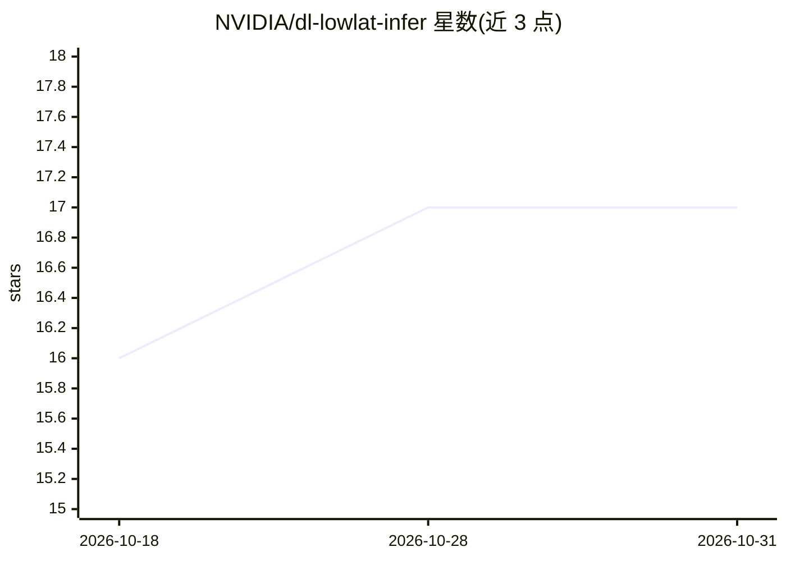

# NVIDIA/dl-lowlat-infer

⭐ 17 · Cuda · Apache-2.0 · 推送 2026-08-31 · [GitHub](https://github.com/NVIDIA/dl-lowlat-infer) · 组织维护

**NVIDIA 的滑动窗口 LSTM 低延迟 CUDA 推理基准工具**

提供 nvLstmInf 可执行二进制，以 CUDA 实现滑动窗口 LSTM 的单步与持久化（persistent timing）内核推理，并附基准测试框架、Python 编排脚本与单元测试。面向需要在 GPU 上测量低延迟 LSTM 推理（含微秒级时间戳采集）的开发者/科研用户。构建要求 gcc(C++20)、CMake>=3.20、CUDA>=13.0，支持 Docker 容器运行、多实例 green context 部署，以及可选 GDRCopy 加速主机-设备传输。

## 筛选速览

| 维度 | 判定 | 备注 |
|---|---|---|
| AI 角色 | `ai-ecosystem` | LLM/agent 周边工具 |
| 许可风险 | `permissive` | Apache-2.0 |
| 部署形态 | `self-host` | docker 或自建部署 |
| 模型依赖 | — | README 未给出锁定关系 |
| 硬件要求 | — | 无带数字的原话,不猜 |
| 安装摩擦 | `low` | 无编译、无系统依赖或容器化 |
| 成熟度 | — | 结构信号不足 |

## 能力要点

- CUDA 实现的单步与持久化内核 LSTM 推理
- 支持单 GPU 多实例（green context、每实例 2 SM）运行
- 提供 Docker 构建运行流程与 Makefile 自动化
- 可选 GDRCopy 低延迟主机-设备内存映射（加速最高 0.5 µs）

## 适用场景

- 在 NVIDIA GPU 上测量滑动窗口 LSTM 推理延迟
- 对比不同 CUDA 架构与内核实现的时间性能
- 在单 GPU 上并行运行多个 LSTM 推理实例做延迟测试

## 场景标签

`模型评测` · 领域:评测与运维

## 证据(README 行号)

> L1: # Low Latency inference for sliding window LSTMs
> L64: * `src/cpp/nvLstmInf`: CUDA based implementation of LSTM Inference
> L140: ./nvLstmInf --precision=32 --algo=SingleStep lstm_s data/lstm_s data/lstm_s.npy 30

## 星数曲线

2026-10-18 16 → 2026-10-31 17（+1）

---
*卡片 v1 · prompt 1.4 · 生成 2026-10-30 · 置信度 high · 依据 README sha `f30fc05cfdae` · [字段定义](../../DATASET.md)*
