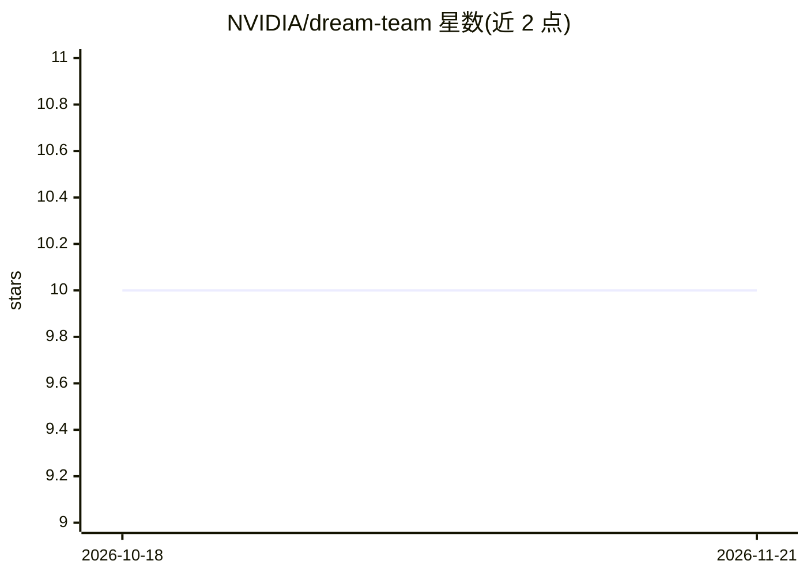

# NVIDIA/dream-team

⭐ 10 · Python · Apache-2.0 · 推送 2026-07-15 · [GitHub](https://github.com/NVIDIA/dream-team) · 组织维护

**面向 ARC-AGI-3 交互环境的多智能体求解器**

随论文《Workspace Optimization: How to Train Your Agent》发布的多智能体求解器，围绕共享可执行世界模型协调六个专职 agent（observer/simulator/双 explorer/critic/team leader），提供 TeamSolver 算法、单游戏与并行多游戏入口、终端仪表盘、本地 FastAPI/React 运行查看器、GIF/APNG 动画渲染器及论文所用游戏生成组件。支持离线模式（ARC-AGI-3 SDK 数据）与竞赛模式（ARC API key），LLM 经 OpenAI 兼容网关接入。需 Python 3.12，目前不接受贡献。

## 筛选速览

| 维度 | 判定 | 备注 |
|---|---|---|
| AI 角色 | `ai-native` | 本体是模型或模型工具 |
| 许可风险 | `permissive` | Apache-2.0 |
| 部署形态 | `library` | 以包/库形式分发 |
| 模型依赖 | — | README 未给出锁定关系 |
| 硬件要求 | — | 无带数字的原话,不猜 |
| 安装摩擦 | `low` | 无编译、无系统依赖或容器化 |
| 成熟度 | — | 结构信号不足 |

## 能力要点

- 六 agent 围绕共享可执行世界模型协作，通过文件共享工作区通信
- 提供离线与竞赛两种运行模式及并行多游戏入口
- 内置本地 FastAPI/React 运行查看器与终端仪表盘
- 附带游戏生成组件与 25 个内置生成游戏（可 --verify 复现 WIN）

## 适用场景

- 在 ARC-AGI-3 离线数据上复现论文实验
- 携带 ARC API key 参加竞赛模式运行
- 用本地查看器检查与分析已有运行结果
- 用 Game Creator 生成并验证新游戏环境

## 场景标签

`多智能体` · 领域:Agent 开发

## 证据(README 行号)

> L3: DreamTeam is a multi-agent solver for interactive ARC-AGI-3 environments. It
> L4: coordinates six specialized agents around a shared, executable world model:
> L49: - An OpenAI-compatible LLM gateway for the configured model profiles

## 星数曲线

2026-10-18 10 → 2026-11-21 10（+0）

---
*卡片 v1 · prompt 1.4 · 生成 2026-11-20 · 置信度 high · 依据 README sha `b94607d591d3` · [字段定义](../../DATASET.md)*
