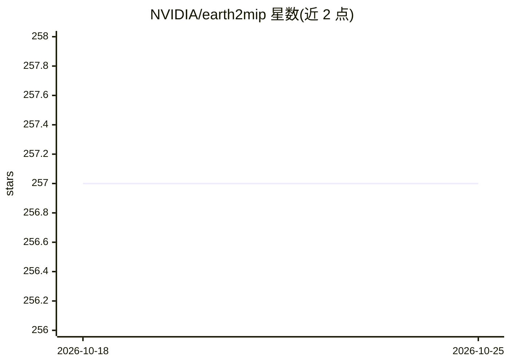

# NVIDIA/earth2mip

⭐ 257 · Python · Apache-2.0 · 推送 2026-01-28 · [GitHub](https://github.com/NVIDIA/earth2mip) · [官网](https://nvidia.github.io/earth2mip/) · 组织维护

**气象气候 AI 模型运行与评分框架，供研究者对比检验**

NVIDIA 维护的 Python 框架，面向气候与气象研究者：为 AI 天气/气候模型提供统一推理接口，可用预训练 checkpoint（FourCastNet、Pangu Weather、Graphcast 等）运行预报，并用 ACC/RMSE 等标准指标实时评分，支持 Jupyter 快速迭代、多 GPU 分布式评分 CLI 与自有模型插件框架。借助 Modulus model zoo 提供基线模型集，各 checkpoint 有独立许可。项目声明处于 Inactive 状态，不再积极开发，一般发布后可从 PyPI 安装，当前需源码安装。

## 筛选速览

| 维度 | 判定 | 备注 |
|---|---|---|
| AI 角色 | `ai-ecosystem` | LLM/agent 周边工具 |
| 许可风险 | `permissive` | Apache-2.0 |
| 部署形态 | `library` | 以包/库形式分发 |
| 模型依赖 | — | README 未给出锁定关系 |
| 硬件要求 | — | 无带数字的原话,不猜 |
| 安装摩擦 | `low` | 无编译、无系统依赖或容器化 |
| 成熟度 | `idea` | |

## 能力要点

- 统一接口运行多种预训练天气 AI 模型（FourCastNet/Pangu/Graphcast 等 10 个）
- ACC/RMSE 等标准指标的实时（on-the-fly）评分
- Python API + 多 GPU 评分 CLI + 自有模型插件框架
- 借助 NVIDIA Modulus model zoo 提供基线模型集

## 适用场景

- 对多个 AI 天气模型运行推理并按统一指标评分对比
- 在 Jupyter 中快速迭代实验 AI 模型对大气物理的刻画
- 接入自有模型 checkpoint 参与社区评分基准

## 场景标签

`模型评测` `推理引擎` · 领域:评测与运维

## 证据(README 行号)

> L12: Earth-2 Model Intercomparison Project (MIP) is a Python based AI framework that
> L18: For instance, the repo provides a uniform interface for running inference using
> L19: pre-trained model checkpoints and scoring the skill of such models using certain
> L20: standard metrics.

## 星数曲线

2026-10-18 257 → 2026-10-25 257（+0）

---
*卡片 v1 · prompt 1.4 · 生成 2026-10-22 · 置信度 mid · 依据 README sha `2d37b856e780` · [字段定义](../../DATASET.md)*
