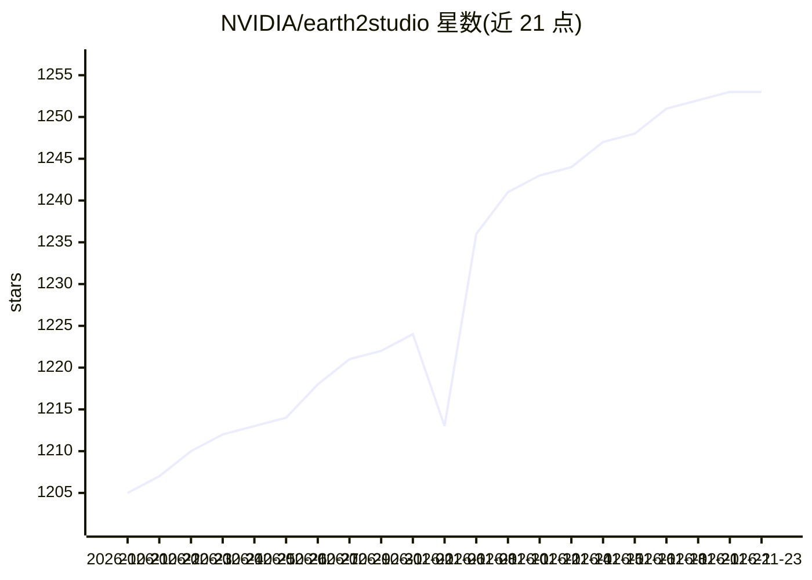

# NVIDIA/earth2studio

⭐ 1,253 · Python · Apache-2.0 · 推送 2026-11-21 · [GitHub](https://github.com/NVIDIA/earth2studio) · [官网](https://nvidia.github.io/earth2studio/) · 组织维护

**天气预报与气候 AI 建模的 Python 框架，供研究与部署**

NVIDIA 开源的深度学习框架，以单一 Python 包汇集天气与气候 AI 模型、生产级数据源、可组合的推理 API 与 GPU 加速工作流。功能覆盖全球与区域预测模型的预报、降水/风速等派生场诊断、稀疏观测同化、公开数据获取、集合与多模型耦合编排，结果可存储为 Zarr/NetCDF。1.0.0 为大版本重构，与 1.0 前版本不兼容，官方提供迁移指南；各模型依赖不同，需按安装指南配置。

## 筛选速览

| 维度 | 判定 | 备注 |
|---|---|---|
| AI 角色 | `ai-native` | 本体是模型或模型工具 |
| 许可风险 | `permissive` | Apache-2.0 |
| 部署形态 | `library` | 以包/库形式分发 |
| 模型依赖 | — | README 未给出锁定关系 |
| 硬件要求 | — | 无带数字的原话,不猜 |
| 安装摩擦 | `low` | 无编译、无系统依赖或容器化 |
| 成熟度 | — | 结构信号不足 |

## 能力要点

- 接入天气与气候 AI 模型集合，含预测、诊断、数据源 API
- 支持观测同化与集合、多模型耦合工作流组合
- 结果输出支持 Zarr、NetCDF 等格式
- 提供 AGENTS.md 与 skills 供编码 agent 引导安装使用

## 适用场景

- 用 AI 模型生成全球或区域天气预报
- 从公开数据源获取并处理分析、预报与观测数据
- 组合多模型工作流并部署为推理服务

## 场景标签

 · 领域:气象/气候科学

## 证据(README 行号)

> L22: Access a leading collection of weather and climate AI models, production-ready data sources,
> L66: - [**Forecast**][e2studio_px_api] with global and regional prognostic AI models.

## 星数曲线

2026-10-21 1,205 → 2026-11-23 1,253（+48）

---
*卡片 v1 · prompt 1.4 · 生成 2026-11-23 · 置信度 high · 依据 README sha `32c215c73bb2` · [字段定义](../../DATASET.md)*
