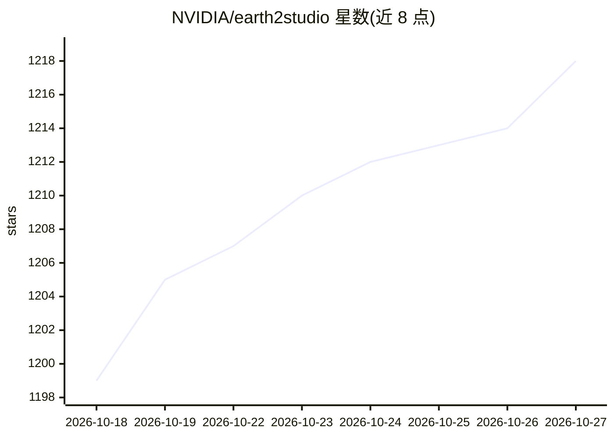

# NVIDIA/earth2studio

⭐ 1,218 · Python · Apache-2.0 · 推送 2026-10-26 · [GitHub](https://github.com/NVIDIA/earth2studio) · [官网](https://nvidia.github.io/earth2studio/) · 组织维护

**构建与部署 AI 天气气候工作流的 Python 推理工具包**

NVIDIA 维护的 Python 包，提供统一 API 接入第三方天气/气候 AI 模型（FourCastNet3、AIFS、GraphCast、CorrDiff、FuXi-S2S 等）、数据源（GFS/IFS/ERA5 等）与输出后端（Zarr），核心组件可组合以链式构建多数据源、多模型的推理流水线，并支持换用替代组件。提供模型动物园与云数据存储访问。注意：模型、权重与数据集的许可归各自提供方所有。附带可配合编码 agent（Claude/Codex 等）的安装与预测技能。

## 筛选速览

| 维度 | 判定 | 备注 |
|---|---|---|
| AI 角色 | `ai-ecosystem` | LLM/agent 周边工具 |
| 许可风险 | `permissive` | Apache-2.0 |
| 部署形态 | `library` | 以包/库形式分发 |
| 模型依赖 | — | README 未给出锁定关系 |
| 硬件要求 | — | 无带数字的原话,不猜 |
| 安装摩擦 | `low` | 无编译、无系统依赖或容器化 |
| 成熟度 | — | 结构信号不足 |

## 能力要点

- 统一 API 接入多种天气/气候 AI 模型与数据源
- 可组合的推理流水线（数据→模型→输出链式连接）
- 模型动物园与云数据存储优化访问
- 提供 agent 辅助安装与首个确定性预报的技能集

## 适用场景

- 用几行代码运行 AI 天气预报（如 FourCastNet3）
- 组合多数据源与多模型搭建气候/天气推理流水线
- 从 ERA5 到 HRRR 的生成式降尺度实验

## 场景标签

`推理引擎` · 领域:训练与推理

## 证据(README 行号)

> L11: Earth2Studio is a Python-based package designed to get users up and running
> L113: Earth2Studio is an *AI inference pipeline toolkit* focused on weather and climate
> L114: applications that is designed to ride on top of different AI frameworks, model

## 星数曲线

2026-10-18 1,199 → 2026-10-27 1,218（+19）

---
*卡片 v1 · prompt 1.4 · 生成 2026-10-21 · 置信度 high · 依据 README sha `d74dd566caf7` · [字段定义](../../DATASET.md)*
