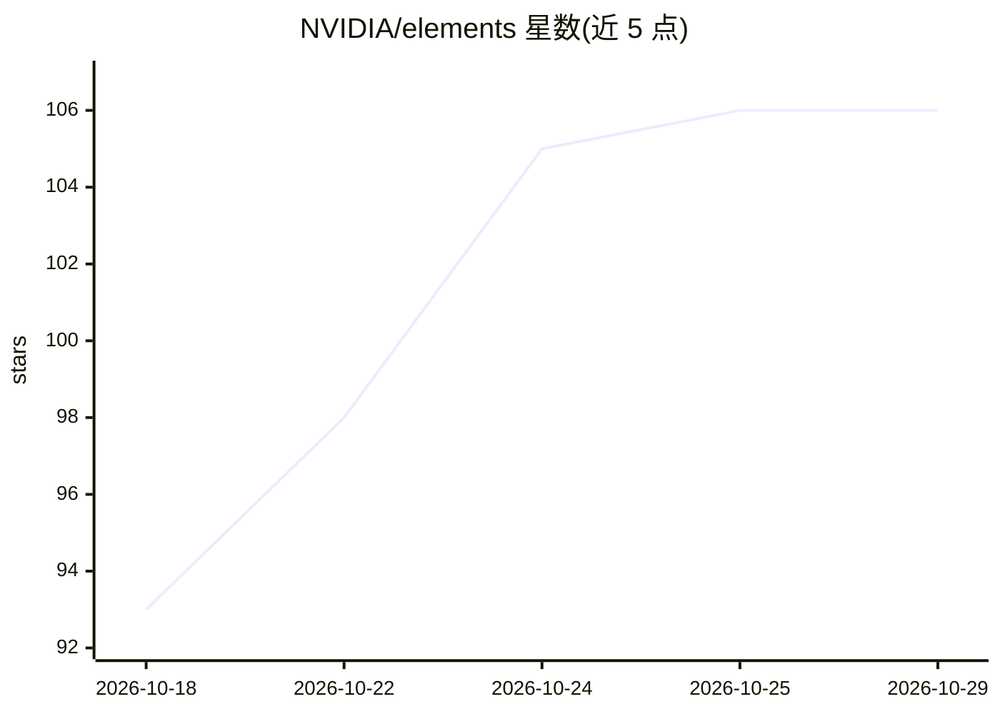

# NVIDIA/elements

⭐ 106 · TypeScript · Apache-2.0 · 推送 2026-10-28 · [GitHub](https://github.com/NVIDIA/elements) · [官网](https://nvidia.github.io/elements/) · 组织维护

**面向 AI 工厂/机器人/自动驾驶的 NVIDIA 设计系统与 UI Agent 工具集**

NVIDIA 维护的设计系统仓库：包含核心 UI 组件库（Web Components，支持 React/Angular/Vue 等）、主题库、CSS 工具与 starter 应用，用于构建 AI/ML 工厂、自动驾驶与机器人操作界面。Agent 相关部分：CLI 与 MCP 向终端和 AI 助手暴露组件 API、tokens、示例与校验，可通过 skills CLI 安装 Elements agent skill。开发采用 pnpm monorepo，依赖 mise 管理工具链（Node.js、pnpm、Go、Git LFS 等），完整 CI 需安装 Go 1.26.x。

## 筛选速览

| 维度 | 判定 | 备注 |
|---|---|---|
| AI 角色 | `ai-ecosystem` | LLM/agent 周边工具 |
| 许可风险 | `permissive` | Apache-2.0 |
| 部署形态 | `library` | 以包/库形式分发 |
| 模型依赖 | — | README 未给出锁定关系 |
| 硬件要求 | — | 无带数字的原话,不猜 |
| 安装摩擦 | `low` | 无编译、无系统依赖或容器化 |
| 成熟度 | — | 结构信号不足 |

## 能力要点

- Web Components 框架无关，可运行于 React/Angular/Vue/Svelte/Lit/纯 HTML
- CLI 与 MCP 暴露组件 API、tokens、示例与校验给 AI 助手
- 主题库与 CSS 工具库配套
- 提供标准化 starter 应用套件

## 适用场景

- 为 AI 基础设施或机器人控制台搭建操作界面
- 让 AI 编码助手通过 MCP 获取组件规范与示例
- 跨框架项目中复用统一的 NVIDIA 风格设计系统

## 场景标签

 · 领域:前端/设计系统（AI 基础设施方向）

## 证据(README 行号)

> L3: NVIDIA Design System and UI Agent Harness for AI/ML Factories, Robotics, and Autonomous Vehicles.
> L5: - **Agent-ready tooling:** CLI and MCP expose component APIs, tokens, examples, imports, validation, and setup to te
> L7: - **Built for AI infrastructure:** Operational UI for AI/ML workloads, autonomous vehicle tools, and robotics consol

## 星数曲线

2026-10-18 93 → 2026-10-29 106（+13）

---
*卡片 v1 · prompt 1.4 · 生成 2026-10-23 · 置信度 high · 依据 README sha `6b6391355007` · [字段定义](../../DATASET.md)*
