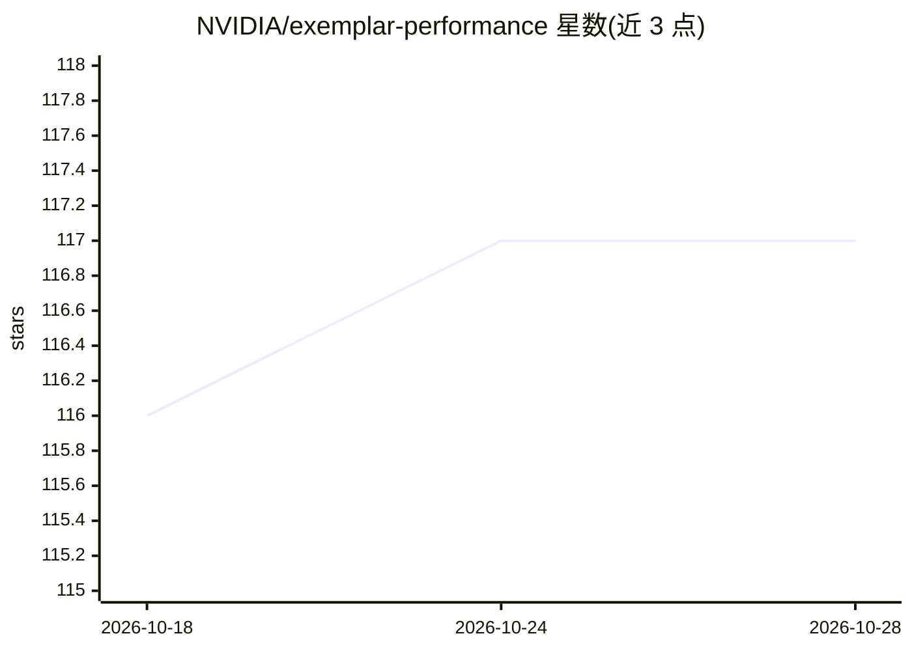

# NVIDIA/exemplar-performance

⭐ 117 · Python · Apache-2.0 · 推送 2026-10-26 · [GitHub](https://github.com/NVIDIA/exemplar-performance) · 组织维护

**NVIDIA 的 AI 工作负载性能基准测试配方集（训练/微调/推理）**

面向 GPU 集群用户的容器化基准测试模板仓库：每个配方对应一个 AI 工作负载（预训练、微调、推理），可在不同集群规模与精度下运行，针对 NVIDIA 参考架构建立基线，产出跨平台可比较的性能指标。支持 Slurm 与 Kubernetes（KAI Scheduler）两类集群，通过交互式 install.sh 安装 CLI 工具（llmb-run/llmb-install），用 llmb-run submit 提交基准任务。限制：需 CUDA 12.3+/NCCL/OFED 等集群环境、Hugging Face 令牌（部分模型需单独申请访问），预训练基准建议预留至少 300GB 存储。

## 筛选速览

| 维度 | 判定 | 备注 |
|---|---|---|
| AI 角色 | `ai-ecosystem` | LLM/agent 周边工具 |
| 许可风险 | `permissive` | Apache-2.0 |
| 部署形态 | `None` |  |
| 模型依赖 | — | README 未给出锁定关系 |
| 硬件要求 | — | 无带数字的原话,不猜 |
| 安装摩擦 | `medium` | 含编译或系统依赖之一 |
| 成熟度 | — | 结构信号不足 |

## 能力要点

- 配方覆盖预训练、微调、推理三类 AI 工作负载，支持多集群规模与精度
- 支持 Slurm（Enroot/Pyxis/PMIx）与 Kubernetes（KAI Scheduler）集群
- llmb-run CLI 提交任务、查看进度、拉取日志与打包结果
- 针对 NVIDIA 参考架构建立性能基线，跨平台产出可比较指标

## 适用场景

- 在自己的 GPU 集群上运行标准化 AI 训练/推理基准
- 对比不同硬件与软件组合下 AI 工作负载的性能
- 为 Exemplar 云认证打包实验结果数据

## 场景标签

 · 领域:AI 基础设施/性能评测

## 证据(README 行号)

> L3: Performance Recipes are ready-to-use templates for evaluating the performance of specific AI use cases across hardwa
> L5: These Performance Recipes support performance characterization:
> L10: Each recipe maps to one workload and can be run at various cluster scales and precisions. These workloads are teste

## 星数曲线

2026-10-18 116 → 2026-10-28 117（+1）

---
*卡片 v1 · prompt 1.4 · 生成 2026-10-23 · 置信度 high · 依据 README sha `465d9b7e9f79` · [字段定义](../../DATASET.md)*
