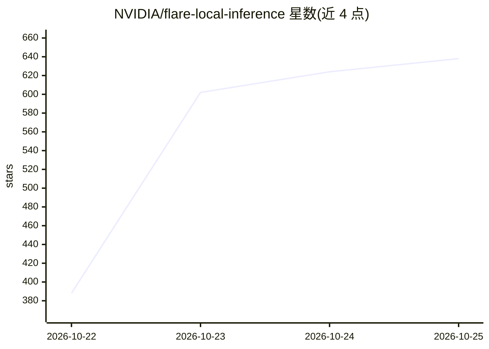

# NVIDIA/flare-local-inference

⭐ 638 · Python · Apache-2.0 · 推送 2026-10-24 · [GitHub](https://github.com/NVIDIA/flare-local-inference) · 组织维护

**面向 NVIDIA SM120/121 GPU 的本地推理服务器，服务编码 Agent 长会话**

Flare 是运行于 NVIDIA SM120/SM121 GPU（如 DGX Spark）的本地推理服务器，面向长对话、编码 Agent 与反复工具调用场景。机制分两段：Ignition 用 PyTorch/Transformers/FlashInfer 加载模型、调优内核并捕获 CUDA 图，打包为运行时包；Helios 是 Rust 运行时，脱离 Python 提供服务。限制：仅支持选定模型配方，README 多处与 vLLM 对比，说明其覆盖范围更窄。

## 筛选速览

| 维度 | 判定 | 备注 |
|---|---|---|
| AI 角色 | `ai-ecosystem` | LLM/agent 周边工具 |
| 许可风险 | `permissive` | Apache-2.0 |
| 部署形态 | `None` |  |
| 模型依赖 | — | README 未给出锁定关系 |
| 硬件要求 | — | 无带数字的原话,不猜 |
| 安装摩擦 | `medium` | 含编译或系统依赖之一 |
| 成熟度 | — | 结构信号不足 |

## 能力要点

- 构建期用 PyTorch 生态（Transformers/FlashInfer/b12x）编译并捕获 CUDA 图
- Rust 运行时 Helios 无 Python 服务，编译在服务前完成
- 将对话状态（含 KV 缓存与循环状态）整体管理，支持复用/分支/恢复
- 面向长会话与编码 Agent 的显存/带宽/计算优化设计

## 适用场景

- 在 DGX Spark 等工作站上运行本地模型服务长对话编码 Agent
- 需要显存与调度协同设计的本地推理部署
- 反复工具调用场景下保持生成响应性

## 场景标签

`推理引擎` · 领域:训练与推理

## 证据(README 行号)

> L5: Flare is a local inference server for NVIDIA SM120/SM121 GPUs, built for
> L15:  Helios, the Rust runtime, serves that package without Python. Compilation and

## 星数曲线

2026-10-22 388 → 2026-10-25 638（+250）

---
*卡片 v1 · prompt 1.4 · 生成 2026-10-21 · 置信度 high · 依据 README sha `e7d567e7b1ff` · [字段定义](../../DATASET.md)*
