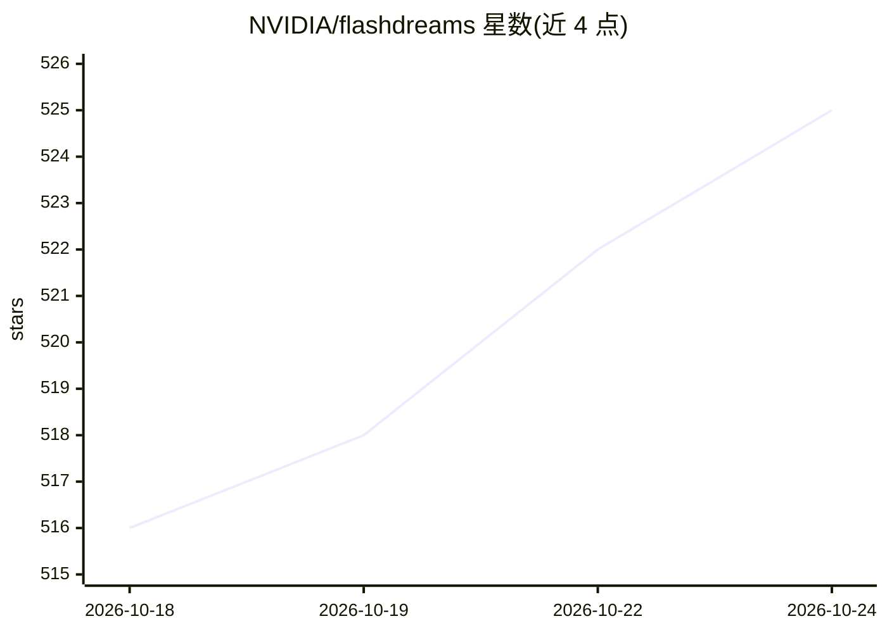

# NVIDIA/flashdreams

⭐ 525 · Python · NOASSERTION · 推送 2026-10-23 · [GitHub](https://github.com/NVIDIA/flashdreams) · [官网](https://nvidia.github.io/flashdreams/) · 组织维护

**面向交互式自回归视频与世界模型的高性能推理服务库**

NVIDIA 维护的推理与 serving 库，面向交互式自回归视频模型与世界模型，起源于 GTC 2026 OmniDreams 闭环演示的运行时，定位为游戏、自动驾驶、机器人、仿真/虚拟环境等实时世界模型应用的通用平台。提供 Demo API 供演示开发者和 Inferencing API 供模型开发者使用；README 展示交互驾驶、crazy-robotaxi、Cosmos3 Nano Sim Auto（多视角驾驶、HD 地图与可选 LiDAR）等演示。完整安装步骤位于外部 quick-start 指南，README 内无具体安装命令。软件会自动获取外部材料，相关许可由使用方自行负责。Apache 2.0 许可发布。

## 筛选速览

| 维度 | 判定 | 备注 |
|---|---|---|
| AI 角色 | `ai-ecosystem` | LLM/agent 周边工具 |
| 许可风险 | `permissive` | NOASSERTION |
| 部署形态 | `None` |  |
| 模型依赖 | — | README 未给出锁定关系 |
| 硬件要求 | — | 无带数字的原话,不猜 |
| 安装摩擦 | `low` | 无编译、无系统依赖或容器化 |
| 成熟度 | — | 结构信号不足 |

## 能力要点

- 自回归视频与世界模型的实时推理与 serving
- 面向演示开发者的 Demo API 与面向模型开发者的 Inferencing API
- 提供交互驾驶、robotaxi、多视角驾驶仿真等演示

## 适用场景

- 为游戏或机器人应用构建实时世界模型推理
- 开发基于世界模型的交互式演示
- 实现自回归视频模型的 serving 与接入

## 场景标签

`推理引擎` · 领域:训练与推理

## 证据(README 行号)

> L6: **FlashDreams** is a high-performance inference and serving library for
> L7: interactive autoregressive video and world models. It began as the optimized
> L35: Implement world-models with our Inferencing API.

## 星数曲线

2026-10-18 516 → 2026-10-24 525（+9）

---
*卡片 v1 · prompt 1.4 · 生成 2026-10-21 · 置信度 high · 依据 README sha `6debfbf2557f` · [字段定义](../../DATASET.md)*
