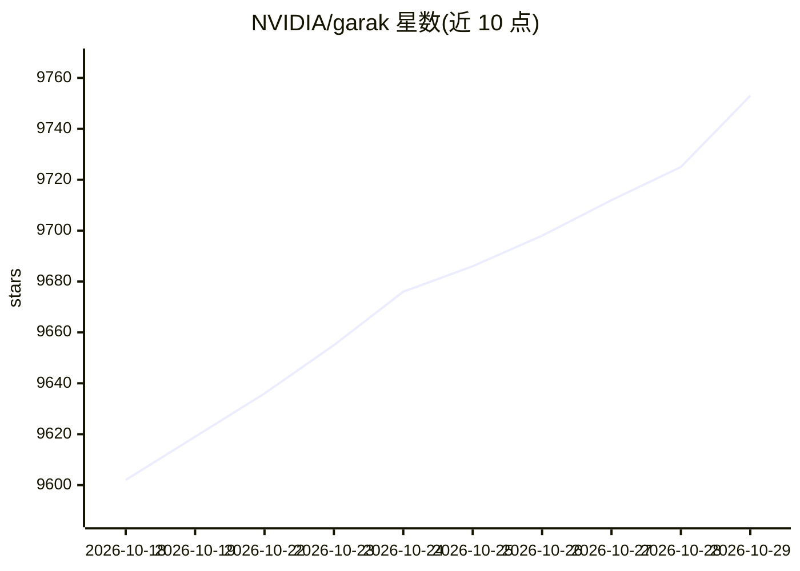

# NVIDIA/garak

⭐ 9,753 · Python · Apache-2.0 · 推送 2026-10-27 · [GitHub](https://github.com/NVIDIA/garak) · [官网](https://discord.gg/uVch4puUCs) · 组织维护

**LLM 漏洞扫描器：探测幻觉、越狱、注入等安全弱点**

NVIDIA 维护的命令行 LLM 红队评测工具，类比 nmap/Metasploit：以静态、动态与自适应 probe 探测模型在幻觉、数据泄露、提示注入、毒性生成、越狱等方面的失败方式，并用配套 detector 输出各 probe 的失败率。支持 Hugging Face、OpenAI、Replicate、Cohere、Groq、NIM、AWS Bedrock、gguf/llama.cpp 及任意 REST 端点作为被测生成器。结果打印到终端并记录于 jsonl 日志，附基础分析脚本。

## 筛选速览

| 维度 | 判定 | 备注 |
|---|---|---|
| AI 角色 | `ai-ecosystem` | LLM/agent 周边工具 |
| 许可风险 | `permissive` | Apache-2.0 |
| 部署形态 | `library` | 以包/库形式分发 |
| 模型依赖 | local-ok | 支持本地模型 |
| 硬件要求 | — | 无带数字的原话,不猜 |
| 安装摩擦 | `low` | 无编译、无系统依赖或容器化 |
| 成熟度 | — | 结构信号不足 |

## 能力要点

- 数十种 probe：DAN、编码注入、GCG 对抗后缀、训练数据重放、包幻觉等
- 支持多种生成器目标：Hugging Face / OpenAI / Bedrock / gguf / REST 等
- 结果以失败率与 jsonl 日志输出，附 analyse_log.py 分析脚本

## 适用场景

- 模型上线前进行安全红队评测
- 对比不同模型对提示注入、越狱攻击的抵抗力
- 扫描自部署模型（Hugging Face/gguf/NIM）的安全弱点

## 场景标签

`模型评测` `网络安全` · 领域:评测与运维

## 证据(README 行号)

> L5: `garak` checks if an LLM can be made to fail in a way we don't want. `garak` probes for hallucination, data leakage,
> L91: `garak` needs to know what model to scan, and by default, it'll try all the probes it knows on that model, using th

## 星数曲线

2026-10-18 9,602 → 2026-10-29 9,753（+151）

---
*卡片 v1 · prompt 1.4 · 生成 2026-10-20 · 置信度 high · 依据 README sha `04e5123cbc84` · [字段定义](../../DATASET.md)*
