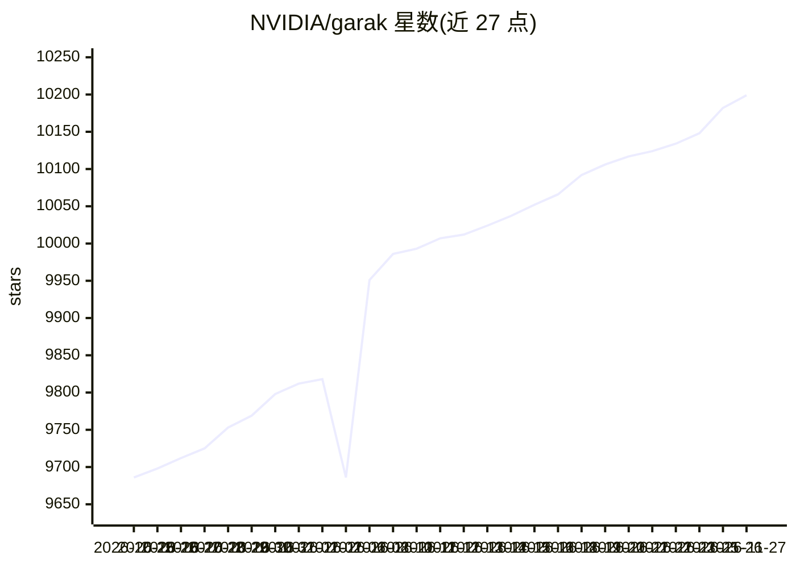

# NVIDIA/garak

⭐ 10,199 · Python · Apache-2.0 · 推送 2026-11-25 · [GitHub](https://github.com/NVIDIA/garak) · [官网](https://discord.gg/uVch4puUCs) · 组织维护

**面向 LLM 应用的漏洞扫描工具：探测越狱、注入与泄露**

garak 是一个命令行 LLM 漏洞扫描工具，用静态、动态与自适应探针检测幻觉、数据泄露、提示注入、毒性生成、越狱等弱点，并对每个探针的探测结果按检测器输出 FAIL 判定与失败率，运行日志写入 .jsonl 文件并附带分析脚本。通过 --target_type/--target_name 指定被测模型，支持 Hugging Face、OpenAI、Bedrock、LiteLLM、REST 端点、gguf/llama.cpp 等多种生成器接口，部分生成器需以环境变量配置 API key。在 Linux 与 OSX 上开发，通过 pip 或 Conda+源码安装。

## 筛选速览

| 维度 | 判定 | 备注 |
|---|---|---|
| AI 角色 | `ai-ecosystem` | LLM/agent 周边工具 |
| 许可风险 | `permissive` | Apache-2.0 |
| 部署形态 | `library` | 以包/库形式分发 |
| 模型依赖 | local-ok | 支持本地模型 |
| 硬件要求 | — | 无带数字的原话,不猜 |
| 安装摩擦 | `low` | 无编译、无系统依赖或容器化 |
| 成熟度 | — | 结构信号不足 |

## 能力要点

- 内置数十种探针：DAN、编码注入、数据泄露复现、包幻觉、PromptInject 等
- 支持 Hugging Face 本地模型、OpenAI、Replicate、Cohere、Groq、Bedrock、NIM 与任意 REST 端点
- 以 FAIL 标记与失败率输出探测结果，日志落盘为 .jsonl 并提供分析脚本
- 提供 --list_probes 列出探针，可按插件族或单个插件指定探测范围

## 适用场景

- 上线前扫描自建 LLM 应用的越狱与提示注入风险
- 检测模型是否会泄露训练数据或生成不存在的软件包
- 对 Hugging Face 上的开源模型跑安全探针并分析失败率

## 场景标签

`模型评测` `网络安全` · 领域:评测与运维

## 证据(README 行号)

> L5: `garak` checks if an LLM-backed application can be made to fail in a way we don't want. `garak` probes for hallucina
> L33: ## LLM support
> L47: `garak` is a command-line tool. It's developed in Linux and OSX.

## 星数曲线

2026-10-25 9,686 → 2026-11-27 10,199（+513）

---
*卡片 v1 · prompt 1.4 · 生成 2026-11-22 · 置信度 high · 依据 README sha `c3467dd65265` · [字段定义](../../DATASET.md)*
