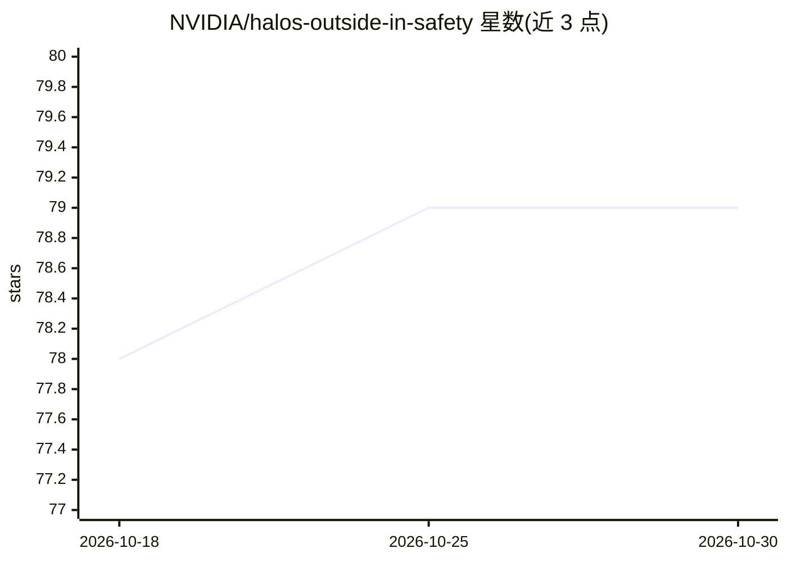

# NVIDIA/halos-outside-in-safety

⭐ 79 · C++ · Apache-2.0 · 推送 2026-10-29 · [GitHub](https://github.com/NVIDIA/halos-outside-in-safety) · 组织维护

**NVIDIA 机器人外部摄像头安全蓝图：用基础设施相机实时控制机器人行为**

NVIDIA Halos for Robotics 的一部分，为构建物理 AI 安全 agent 提供的开源参考架构（early access，非生产用途）。三支柱组成：可替换的 AI 感知后端（VSS Blueprint）、负责事件集成与决策的 Safety Core（CMake，源码内沿用 PSF 旧名）、基于 Isaac Sim 的 SIL/HIL 闭环测试。参考场景为自动挂车装载：固定摄像头监测工人与叉车并实时判定安全时机。提供 base/sil/hil 三种部署 profile，经 Docker Compose 或 NVIDIA Brev 云实例部署，运行于 x86 或 IGX Thor，需 NGC Early-Access 权限。

## 筛选速览

| 维度 | 判定 | 备注 |
|---|---|---|
| AI 角色 | `ai-ecosystem` | LLM/agent 周边工具 |
| 许可风险 | `permissive` | Apache-2.0 |
| 部署形态 | `self-host` | docker 或自建部署 |
| 模型依赖 | — | README 未给出锁定关系 |
| 硬件要求 | — | 无带数字的原话,不猜 |
| 安装摩擦 | `low` | 无编译、无系统依赖或容器化 |
| 成熟度 | `idea` | |

## 能力要点

- 三支柱架构：AI 感知 + Safety Core + Isaac Sim 闭环测试
- base/sil/hil 三种部署 profile，Docker Compose 一键部署
- Brev Launchable 云 GPU 实例上单 notebook 拉起完整闭环
- 提供 agentic skill（hoisa-deploy-profile）端到端部署

## 适用场景

- 为仓储机器人原型搭建外部摄像头安全监控系统
- 在 Isaac Sim 中做安全决策的软件在环测试
- 评估基础设施相机 + AI 感知的安全架构可行性

## 场景标签

`目标检测` · 领域:感知与多模态

## 证据(README 行号)

> L11: NVIDIA Halos Outside-In Safety Blueprint is a reference architecture for building safety agents and part of NVIDIA 
> L13: NVIDIA Halos Outside-In Safety Blueprint extends robot perception beyond onboard sensors by using external infrastr
> L16: An agent built using the blueprint will leverage fixed infrastructure cameras and vision agents to monitor and anal

## 星数曲线

2026-10-18 78 → 2026-10-30 79（+1）

---
*卡片 v1 · prompt 1.4 · 生成 2026-10-24 · 置信度 mid · 依据 README sha `c6ae53c10fe9` · [字段定义](../../DATASET.md)*
