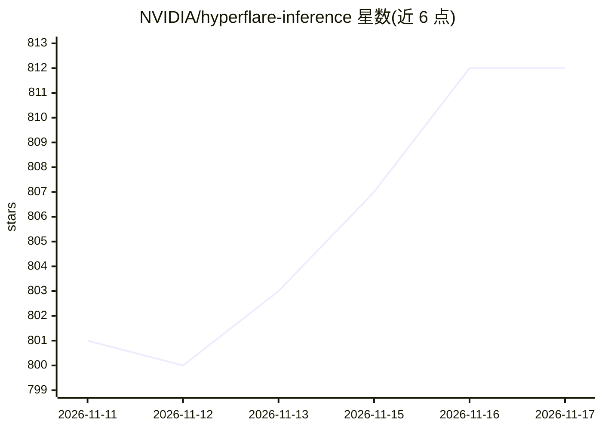

# NVIDIA/hyperflare-inference

⭐ 812 · Python · Apache-2.0 · 推送 2026-11-16 · [GitHub](https://github.com/NVIDIA/hyperflare-inference) · 组织维护

**面向 NVIDIA SM120/SM121 GPU 的本地推理服务器，服务长对话与编码 agent**

Hyperflare 是运行于 NVIDIA SM120/SM121 GPU（如 DGX Spark 工作站）的本地推理服务器，面向长对话、编码 agent 与重复工具调用场景。机制上分两阶段：Ignition 用 PyTorch/Transformers/FlashInfer 加载模型、编译前向并捕获 CUDA 图，生成运行时核心；Helios 用 Rust 运行时在不依赖 Python 的情况下提供服务。明确声明为研究原型，且不替代 vLLM 等生产推理引擎。模型覆盖范围有限，按选定模型与本地负载取舍。项目代码采用 Apache 2.0 许可。

## 筛选速览

| 维度 | 判定 | 备注 |
|---|---|---|
| AI 角色 | `ai-ecosystem` | LLM/agent 周边工具 |
| 许可风险 | `permissive` | Apache-2.0 |
| 部署形态 | `None` |  |
| 模型依赖 | — | README 未给出锁定关系 |
| 硬件要求 | — | 无带数字的原话,不猜 |
| 安装摩擦 | `medium` | 含编译或系统依赖之一 |
| 成熟度 | `idea` | |

## 能力要点

- PyTorch 生态构建编译，Rust 运行时 Helios 无 Python 服务
- 将对话状态（含循环状态与 KV 缓存）作为整体管理，支持复用/分支/恢复
- 面向 SM120/SM121 GPU 与 DGX Spark 等紧凑系统优化内存与带宽
- 官方声明为研究原型，非生产推理引擎替代品

## 适用场景

- 在 DGX Spark 等 NVIDIA 工作站上本地运行选定模型服务编码 agent
- 需要长对话与频繁工具调用下保持生成响应的本地部署
- 研究 CUDA 图编译与 Rust 推理服务架构

## 场景标签

`推理引擎` · 领域:训练与推理

## 证据(README 行号)

> L5: Hyperflare is a local inference server for NVIDIA SM120/SM121 GPUs, built for
> L18:  Helios, the Rust runtime, serves that core without Python. Compilation and

## 星数曲线

2026-11-11 801 → 2026-11-17 812（+11）

---
*卡片 v1 · prompt 1.4 · 生成 2026-11-17 · 置信度 high · 依据 README sha `4413a4983636` · [字段定义](../../DATASET.md)*
