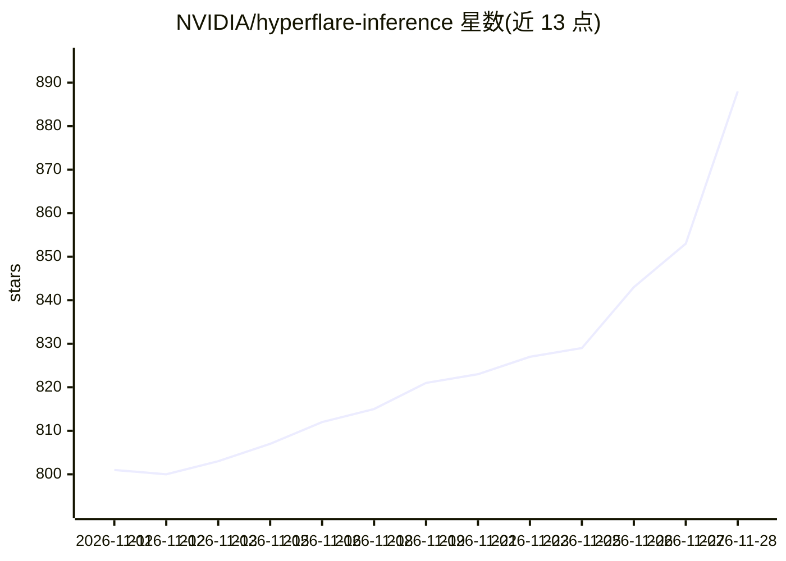

# NVIDIA/hyperflare-inference

⭐ 888 · Rust · Apache-2.0 · 推送 2026-11-27 · [GitHub](https://github.com/NVIDIA/hyperflare-inference) · 组织维护

**面向 NVIDIA SM120/121 GPU 的本地推理服务器**

Hyperflare 是面向 NVIDIA SM120/SM121 GPU（如 DGX Spark 等工作站与紧凑系统）的本地推理服务器，面向长对话、编码 agent 与反复工具调用场景。构建阶段使用 PyTorch、Transformers 与 FlashInfer/b12x 加载模型、调优内核、编译前向并捕获 CUDA 图，再由 Rust 运行时 Helios 在无 Python 环境下提供服务；对话状态（含循环状态与 KV 缓存）被显式统一管理。官方模型配方位于独立仓库 local-inference-lab/hyperflare-recipes。项目自述为研究原型，代码采用 Apache 2.0 许可。

## 筛选速览

| 维度 | 判定 | 备注 |
|---|---|---|
| AI 角色 | `ai-ecosystem` | LLM/agent 周边工具 |
| 许可风险 | `permissive` | Apache-2.0 |
| 部署形态 | `None` |  |
| 模型依赖 | — | README 未给出锁定关系 |
| 硬件要求 | — | 无带数字的原话,不猜 |
| 安装摩擦 | `medium` | 含编译或系统依赖之一 |
| 成熟度 | `idea` | |

## 能力要点

- 构建期用 PyTorch 生态编译并捕获 CUDA 图，服务期由 Rust 运行时（Helios）无 Python 提供服务
- 显式管理对话状态（循环状态与 KV 缓存），支持复用、分支与恢复
- 模型实现复用 PyTorch 生态，专注 SM120/SM121 硬件与选定模型
- 提供 CLI runner 与配置指南，支持 Windows 原生开发与预构建模型核服务

## 适用场景

- 在 DGX Spark 等 SM120/121 设备上本地部署大模型推理服务
- 为编码 agent 与反复工具调用提供长对话推理后端
- 在本地系统中延长内存与带宽可支撑的会话规模

## 场景标签

`推理引擎` · 领域:训练与推理

## 证据(README 行号)

> L5: Hyperflare is a local inference server for NVIDIA SM120/SM121 GPUs, built for
> L18:  Helios, the Rust runtime, serves that core without Python. Compilation and
> L37: vLLM covers a much broader range of models,

## 星数曲线

2026-11-11 801 → 2026-11-28 888（+87）

---
*卡片 v1 · prompt 1.4 · 生成 2026-11-25 · 置信度 high · 依据 README sha `65820cf69216` · [字段定义](../../DATASET.md)*
