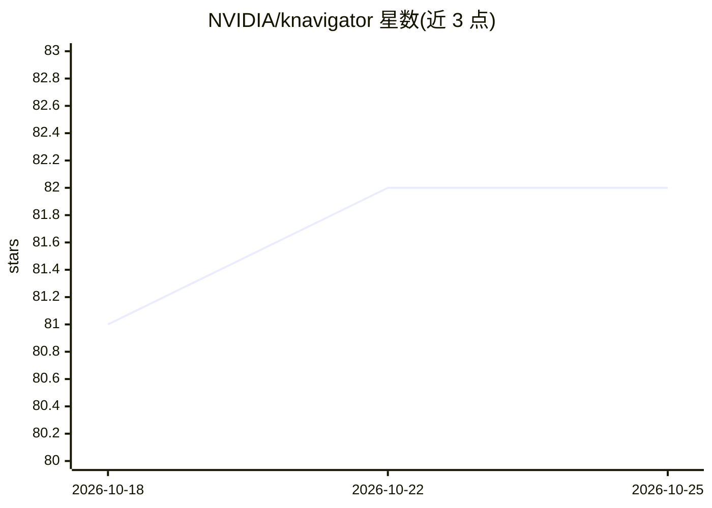

# NVIDIA/knavigator

⭐ 82 · Go · Apache-2.0 · 推送 2026-10-25 · [GitHub](https://github.com/NVIDIA/knavigator) · 组织维护

**Kubernetes 上 AI/ML 调度系统的测试与优化工具包**

面向大规模 Kubernetes 集群中 AI/ML 调度系统的开发、测试与优化工具包：通过与 Kubernetes API 交互执行任务序列，支持操作 Kubernetes 对象、评估 PromQL 查询，覆盖测试、故障排查、基准测试、混沌工程与性能分析。可运行在集群内或集群外；借助 KWOK 创建虚拟节点以低成本开展大规模实验。提供独立模式（YAML 描述任务）、HTTP/gRPC 服务器模式及作为包/库集成三种使用方式；任务串行执行，任一失败则整个测试标记失败。

## 筛选速览

| 维度 | 判定 | 备注 |
|---|---|---|
| AI 角色 | `ai-ecosystem` | LLM/agent 周边工具 |
| 许可风险 | `permissive` | Apache-2.0 |
| 部署形态 | `None` |  |
| 模型依赖 | — | README 未给出锁定关系 |
| 硬件要求 | — | 无带数字的原话,不猜 |
| 安装摩擦 | `low` | 无编译、无系统依赖或容器化 |
| 成熟度 | — | 结构信号不足 |

## 能力要点

- 通过 Kubernetes API 执行任务序列，支持 PromQL 查询评估
- 借助 KWOK 创建虚拟节点，低成本开展大规模调度实验
- 支持独立 YAML 模式、HTTP/gRPC 服务器与包/库集成三种运行形态

## 适用场景

- 对 AI/ML 批调度系统做测试与基准测试
- 在大规模模拟集群上进行调度性能分析与混沌工程实验
- 以库或服务器形式集成到现有测试框架中

## 场景标签

 · 领域:云原生/AI 基础设施

## 证据(README 行号)

> L10: Knavigator is a project designed to analyze, optimize, and compare scheduling systems, with a focus on AI/ML worklo
> L18: To facilitate large-scale experiments without the overhead of running actual user workloads, Knavigator utilizes KW

## 星数曲线

2026-10-18 81 → 2026-10-25 82（+1）

---
*卡片 v1 · prompt 1.4 · 生成 2026-10-24 · 置信度 high · 依据 README sha `b54f094ffb32` · [字段定义](../../DATASET.md)*
