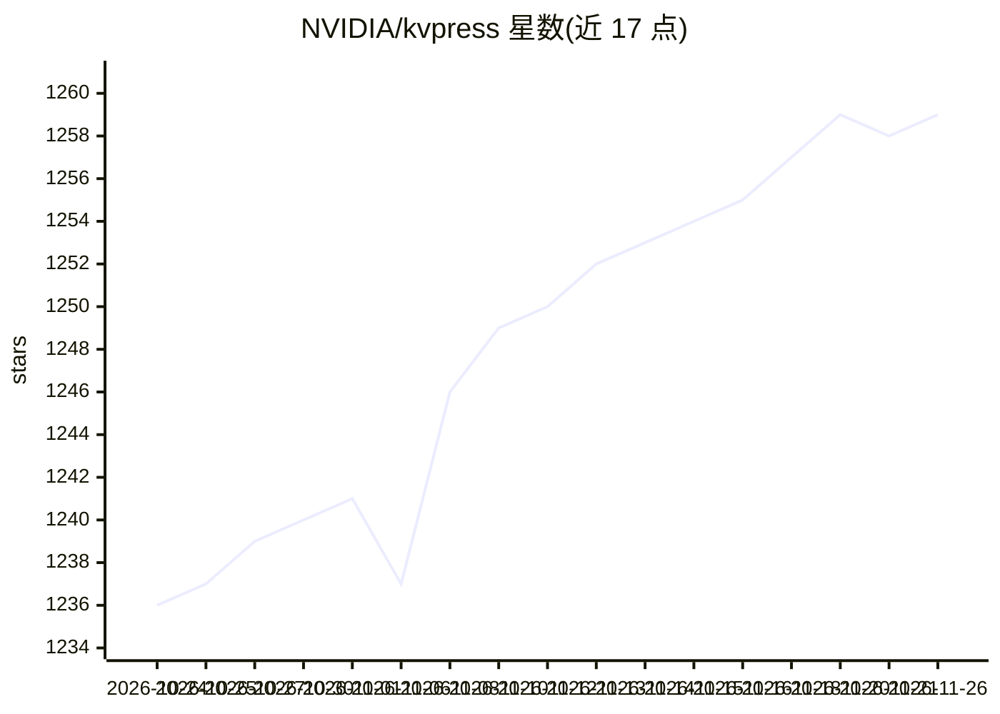

# NVIDIA/kvpress

⭐ 1,259 · Python · Apache-2.0 · 推送 2026-11-23 · [GitHub](https://github.com/NVIDIA/kvpress) · 组织维护

**为长上下文 LLM 研究者提供 KV cache 压缩方法与基准测试**

基于 🤗 transformers 的 KV cache 压缩库：提供 30 余种 training-free 的 "press" 方法（如 ExpectedAttention、SnapKV、StreamingLLM 等），在 prefill 或 decoding 阶段剪除低重要性 KV 对，通过自定义 pipeline 一行接入生成流程；附带 CLI 在 RULER 等长上下文基准上评测各方法准确率与峰值内存收益，支持通过 transformers QuantizedCache 做 KV cache 量化、accelerate 多 GPU 推理。面向开发新压缩方法的研究者与开发者，README 注明部分 press 依赖模型架构，已测试 Llama/Mistral/Phi3/Qwen2/Qwen3/Gemma3 等架构。

## 筛选速览

| 维度 | 判定 | 备注 |
|---|---|---|
| AI 角色 | `ai-ecosystem` | LLM/agent 周边工具 |
| 许可风险 | `permissive` | Apache-2.0 |
| 部署形态 | `library` | 以包/库形式分发 |
| 模型依赖 | — | README 未给出锁定关系 |
| 硬件要求 | — | 无带数字的原话,不猜 |
| 安装摩擦 | `low` | 无编译、无系统依赖或容器化 |
| 成熟度 | — | 结构信号不足 |

## 能力要点

- 30+ 种 training-free KV cache 压缩方法（BasePress/ScorerPress 体系）
- 注册为 transformers pipeline（kv-press-text-generation），处理 chat template 与分词
- 支持 prefill 与 decoding 两个阶段的压缩（DecodingPress）
- 提供 CLI 在长上下文基准上评测准确率、内存与吞吐收益

## 适用场景

- 为长上下文推理降低 KV cache 显存占用
- 研究者在统一框架下开发与对比新压缩方法
- 测量压缩比与峰值内存/时间收益

## 场景标签

`模型评测` `模型量化` · 领域:评测与运维

## 证据(README 行号)

> L11: Deploying long-context LLMs is costly due to the linear growth of the key-value (KV) cache in transformer models. F
> L37: KVPress provides a set of "presses" that compress the KV cache during the prefilling-phase. Each press is associate

## 星数曲线

2026-10-24 1,236 → 2026-11-26 1,259（+23）

---
*卡片 v1 · prompt 1.4 · 生成 2026-11-24 · 置信度 high · 依据 README sha `f11fb2eefeaf` · [字段定义](../../DATASET.md)*
