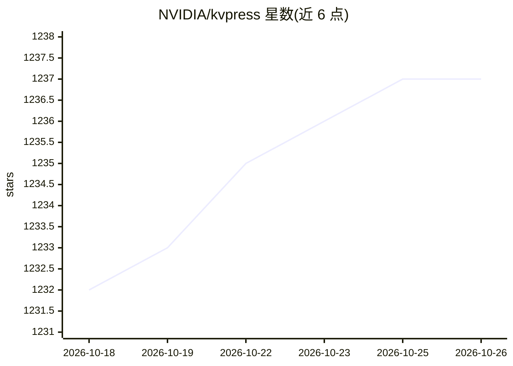

# NVIDIA/kvpress

⭐ 1,237 · Python · Apache-2.0 · 推送 2026-10-21 · [GitHub](https://github.com/NVIDIA/kvpress) · 组织维护

**面向研究者的 LLM KV cache 压缩方法库与评测工具**

基于 🤗 transformers 实现的 Python 库，提供 30 余种训练无关的 KV cache 压缩方法（presses），在 prefilling 阶段（以及实验性的 decoding 阶段）通过 forward hook 剪枝 KV 对，降低长上下文推理的显存占用与解码耗时。附带自定义生成 pipeline、CLI 评测工具（长上下文数据集准确性、速度与显存）、RULER 排行榜与 KV cache 量化支持。面向该领域的研究者与开发者，部分 press 依赖模型架构，官方测试覆盖 Llama、Mistral、Phi3、Qwen2/3、Gemma3。

## 筛选速览

| 维度 | 判定 | 备注 |
|---|---|---|
| AI 角色 | `ai-ecosystem` | LLM/agent 周边工具 |
| 许可风险 | `permissive` | Apache-2.0 |
| 部署形态 | `library` | 以包/库形式分发 |
| 模型依赖 | — | README 未给出锁定关系 |
| 硬件要求 | — | 无带数字的原话,不猜 |
| 安装摩擦 | `low` | 无编译、无系统依赖或容器化 |
| 成熟度 | — | 结构信号不足 |

## 能力要点

- 30 余种 KV cache 压缩方法（ScorerPress 及多种 wrapper，可组合）
- 压缩默认发生在 prefilling 阶段，DecodingPress 支持解码期周期压缩
- CLI 在多个长上下文数据集上评测 press 的准确性/速度/显存
- 支持 QuantizedCache KV 量化与 accelerate 多 GPU 推理

## 适用场景

- 在长上下文推理中压缩 KV cache 以降低显存与加快解码
- 对比评测不同 KV 压缩方法在 RULER 等基准上的表现
- 研究人员基于 BasePress 快速实现新的压缩方法

## 场景标签

`模型评测` · 领域:评测与运维

## 证据(README 行号)

> L11: Deploying long-context LLMs is costly due to the linear growth of the key-value (KV) cache in transformer models. F
> L37: KVPress provides a set of "presses" that compress the KV cache during the prefilling-phase. Each press is associate

## 星数曲线

2026-10-18 1,232 → 2026-10-26 1,237（+5）

---
*卡片 v1 · prompt 1.4 · 生成 2026-10-21 · 置信度 high · 依据 README sha `1fae38da7d06` · [字段定义](../../DATASET.md)*
