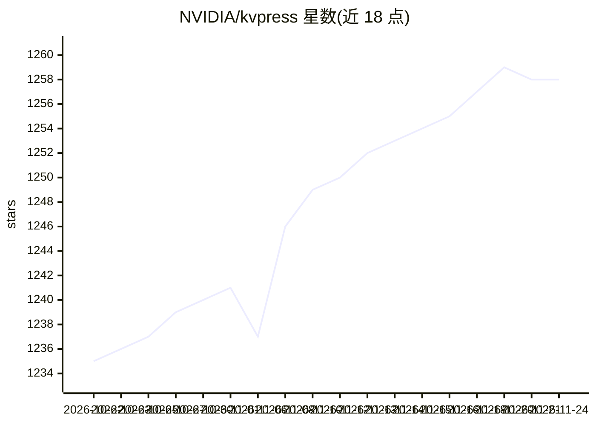

# NVIDIA/kvpress

⭐ 1,258 · Python · Apache-2.0 · 推送 2026-11-16 · [GitHub](https://github.com/NVIDIA/kvpress) · 组织维护

**给研究者的 LLM KV cache 压缩方法实现与评测库**

基于 🤗 transformers 的 KV cache 压缩库：在 prefill 阶段（及实验性的解码阶段）通过 "presses" 对注意力层注册 forward hook 剪除或压缩 KV 对，提供 40 余种 training-free 方法（KNorm、SnapKV、ExpectedAttention、KVzip 等）及组合包装器，压缩比与 target_size 可配置。面向研究该领域的开发者和研究人员，简化新方法的开发与基准评测；附 RULER 等长上下文基准的 CLI 评测、速度/内存测量 notebook 与 Hugging Face Leaderboard。部分 press 依赖模型架构，已测试 Llama/Mistral/Phi3/Qwen2/Qwen3/Gemma3 等实现。

## 筛选速览

| 维度 | 判定 | 备注 |
|---|---|---|
| AI 角色 | `ai-ecosystem` | LLM/agent 周边工具 |
| 许可风险 | `permissive` | Apache-2.0 |
| 部署形态 | `library` | 以包/库形式分发 |
| 模型依赖 | — | README 未给出锁定关系 |
| 硬件要求 | — | 无带数字的原话,不猜 |
| 安装摩擦 | `low` | 无编译、无系统依赖或容器化 |
| 成熟度 | — | 结构信号不足 |

## 能力要点

- 实现 40 余种 KV cache 压缩方法（presses），均为 training-free（少量除外）
- 注册为 transformers pipeline（kv-press-text-generation），自动处理 chat template 与 tokenization
- 提供 CLI 在长上下文基准上评测各 press 的准确性，以及速度/内存测量 notebook
- 通过 accelerate 支持多 GPU 推理，支持经 transformers QuantizedCache 的 KV cache 量化

## 适用场景

- 长上下文 LLM 部署时降低 KV cache 内存占用
- 为新的 KV cache 压缩方法做开发与基准对比
- 测量不同压缩比下的显存节省与解码提速

## 场景标签

`模型评测` `模型量化` `推理引擎` · 领域:评测与运维

## 证据(README 行号)

> L11: Deploying long-context LLMs is costly due to the linear growth of the key-value (KV) cache in transformer models. F
> L37: KVPress provides a set of "presses" that compress the KV cache during the prefilling-phase. Each press is associate
> L131: We provide a simple CLI to evaluate the performance of different presses on several long-context datasets.

## 星数曲线

2026-10-22 1,235 → 2026-11-24 1,258（+23）

---
*卡片 v1 · prompt 1.4 · 生成 2026-11-23 · 置信度 high · 依据 README sha `6738c33b3669` · [字段定义](../../DATASET.md)*
