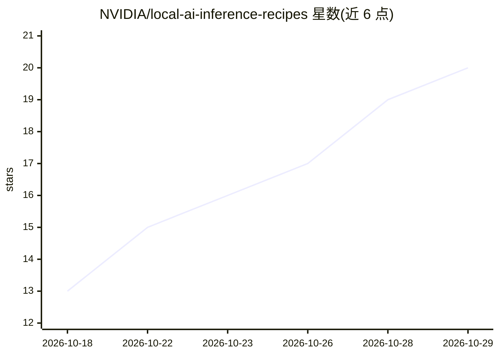

# NVIDIA/local-ai-inference-recipes

⭐ 20 · Apache-2.0 · 推送 2026-10-24 · [GitHub](https://github.com/NVIDIA/local-ai-inference-recipes) · [官网](https://nvidia.github.io/local-ai-inference-recipes/) · 组织维护

**NVIDIA 本地硬件上运行模型的推荐配方清单**

NVIDIA 维护的本地 AI 推理配方（recipes）集合：每条配方给出确切的模型 checkpoint、推理后端与推荐设置，用户按步骤选择模型与硬件配置、设置环境变量、复制运行 setup 与 launch 命令，并用附带客户端示例测试端点。recommended_catalog.json 按 backend 与操作系统分组列出精选配方。仓库声明为进行中、不接受外部 PR；文件以 Apache-2.0 许可为主，.yaml/.html 文件为 NVIDIA 专有许可。

## 筛选速览

| 维度 | 判定 | 备注 |
|---|---|---|
| AI 角色 | `ai-knowledge` | 知识聚合/清单类 |
| 许可风险 | `permissive` | Apache-2.0 |
| 部署形态 | `None` |  |
| 模型依赖 | — | README 未给出锁定关系 |
| 硬件要求 | — | 无带数字的原话,不猜 |
| 安装摩擦 | `low` | 无编译、无系统依赖或容器化 |
| 成熟度 | `idea` | |

## 能力要点

- 每条配方含确切模型 checkpoint、推理后端与推荐设置
- recommended_catalog.json 按后端与操作系统分组精选配方
- 面向 NVIDIA 本地硬件的运行步骤（环境变量/setup/launch/客户端示例）

## 适用场景

- 在 NVIDIA 本地硬件上查找特定模型的推荐推理配置
- 按后端与操作系统筛选经过验证的模型运行配方
- 获取可直接复制的启动命令与端点测试示例

## 场景标签

`精选清单` · 领域:学习与行业

## 证据(README 行号)

> L1: # Local AI Inference Recipes
> L3: This repository contains recommended recipes for running models on NVIDIA local hardware. Each recipe contains the e
> L22: `recommended_catalog.json` lists a curated set of standout recipes, grouped by backend and operating system.

## 星数曲线

2026-10-18 13 → 2026-10-29 20（+7）

---
*卡片 v1 · prompt 1.4 · 生成 2026-10-28 · 置信度 high · 依据 README sha `eb4ed2498d12` · [字段定义](../../DATASET.md)*
