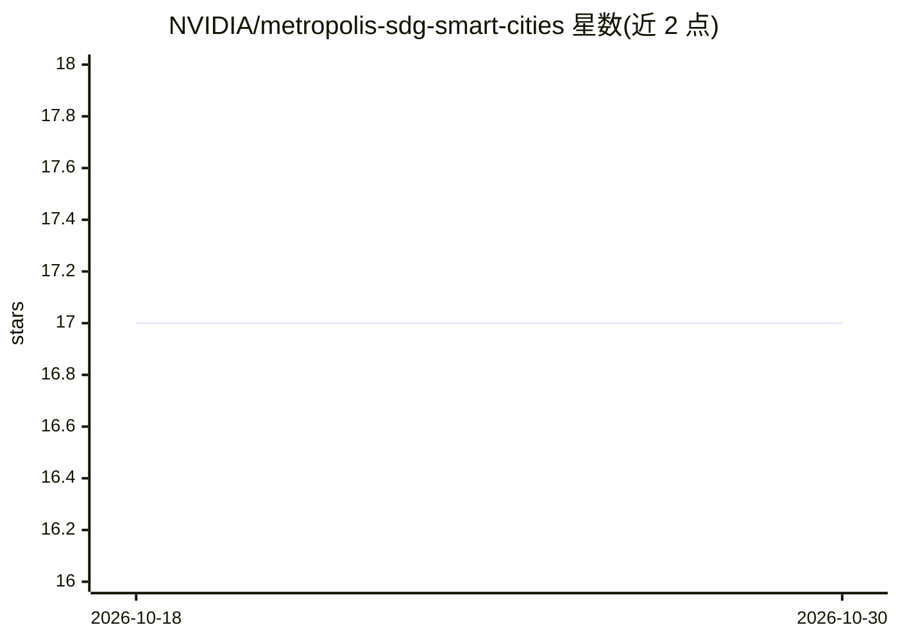

# NVIDIA/metropolis-sdg-smart-cities

⭐ 17 · Python · Apache-2.0 · 推送 2025-12-01 · [GitHub](https://github.com/NVIDIA/metropolis-sdg-smart-cities) · 组织维护

**面向智慧城市的合成数据生成流水线：为 VLM 训练产数据**

NVIDIA Metropolis 的合成数据生成（SDG）recipe：在 CARLA 中仿真交通场景并提取 RGB、深度、分割、法线、2D/3D 边界框等真值，经 Cosmos-Transfer2.5 做照片级增强以弥合 sim-to-real 差距，再做 SoM 对齐后处理与 Q&A caption 生成，产出可用于 Cosmos Reason 等 VLM 微调的数据集。面向构建智慧城市感知/VLM 系统的 ML 工程师与研究者。以 Docker Compose 栈交付（Workbench、CARLA 服务器、NVIDIA NIM 服务），需 Linux + NVIDIA GPU（NIM 服务建议 80GB 显存）、NGC API key 与 HF token，存储约 250GB。

## 筛选速览

| 维度 | 判定 | 备注 |
|---|---|---|
| AI 角色 | `ai-ecosystem` | LLM/agent 周边工具 |
| 许可风险 | `permissive` | Apache-2.0 |
| 部署形态 | `self-host` | docker 或自建部署 |
| 模型依赖 | — | README 未给出锁定关系 |
| 硬件要求 | — | 无带数字的原话,不猜 |
| 安装摩擦 | `low` | 无编译、无系统依赖或容器化 |
| 成熟度 | — | 结构信号不足 |

## 能力要点

- CARLA 仿真场景的真值提取（RGB/深度/分割/法线/2D-3D 框/事件）
- COSMOS-Transfer 照片级增强弥合 sim-to-real 差距
- SoM 对齐后处理与面向 VLM 后训练的 Q&A caption 生成
- Docker Compose 一键部署，支持同机/异机两种模式

## 适用场景

- 为交通感知 VLM 生成领域微调数据集
- 用仿真器批量生成带真值标注的多样化交通场景
- 将合成数据照片级增强以贴近真实部署环境

## 场景标签

`微调` · 领域:训练与推理

## 证据(README 行号)

> L3: An end-to-end workflow for generating photo-realistic synthetic data for Vision-Language Models (VLMs) training on t
> L25: - Generate post-training datasets for model fine-tuning
> L29: The output of this recipe is designed to offer a simple hand-off for further fine-tuning and deployment in the metr

## 星数曲线

2026-10-18 17 → 2026-10-30 17（+0）

---
*卡片 v1 · prompt 1.4 · 生成 2026-10-30 · 置信度 high · 依据 README sha `972ac0db16fd` · [字段定义](../../DATASET.md)*
