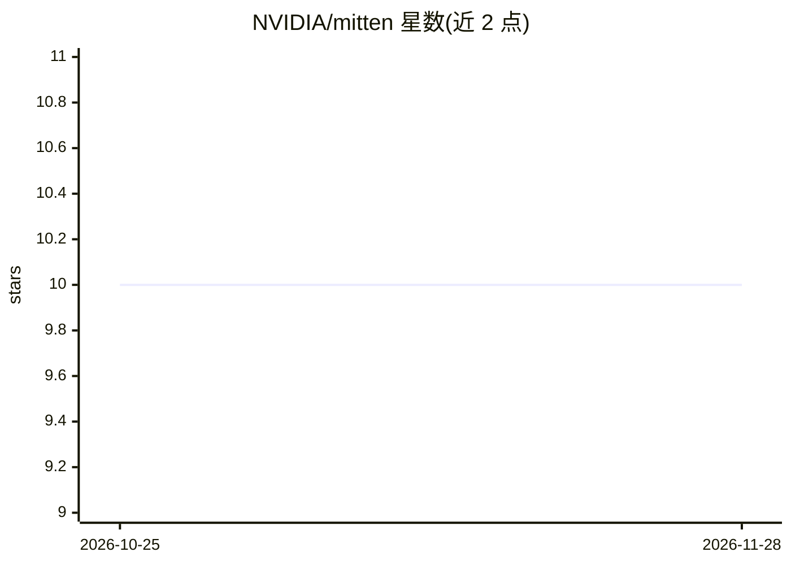

# NVIDIA/mitten

⭐ 10 · Python · Apache-2.0 · 推送 2026-02-25 · [GitHub](https://github.com/NVIDIA/mitten) · 组织维护

**NVIDIA 运行 MLPerf Inference 基准测试的框架**

Mitten（MLPerf Inference Test Bench）是 NVIDIA 用于提交 MLPerf Inference 基准测试代码的框架，读取并运行 MLPerf Inference 基准。功能包括系统检测、基准测试配置、以及作为独立可执行文件运行的 SUT Harness。README 说明该框架针对 NVIDIA GPU 系统做了优化，同时支持任意系统。面向参与 MLPerf Inference 基准测试提交的用户，可见内容仅列出功能条目，未给出安装步骤。

## 筛选速览

| 维度 | 判定 | 备注 |
|---|---|---|
| AI 角色 | `ai-ecosystem` | LLM/agent 周边工具 |
| 许可风险 | `permissive` | Apache-2.0 |
| 部署形态 | `None` |  |
| 模型依赖 | — | README 未给出锁定关系 |
| 硬件要求 | — | 无带数字的原话,不猜 |
| 安装摩擦 | `low` | 无编译、无系统依赖或容器化 |
| 成熟度 | — | 结构信号不足 |

## 能力要点

- 运行 MLPerf Inference 基准测试
- 系统检测与基准测试配置
- SUT Harness 以独立可执行文件运行
- 支持任意系统，对 NVIDIA GPU 系统做优化

## 适用场景

- 为 MLPerf Inference 提交准备并运行基准测试代码
- 在不同硬件系统上配置推理基准
- 检测并管理被测系统信息

## 场景标签

`模型评测` · 领域:评测与运维

## 证据(README 行号)

> L3: **M**LPerf **I**nference **T**es**t** B**en**ch, or Mitten, is a framework by NVIDIA to run the [MLPerf Inference
> L8: Mitten, while more optimized for NVIDIA GPU-based systems, is a generic framework that supports arbitrary systems. S

## 星数曲线

2026-10-25 10 → 2026-11-28 10（+0）

---
*卡片 v1 · prompt 1.4 · 生成 2026-11-20 · 置信度 high · 依据 README sha `50e11a011d22` · [字段定义](../../DATASET.md)*
