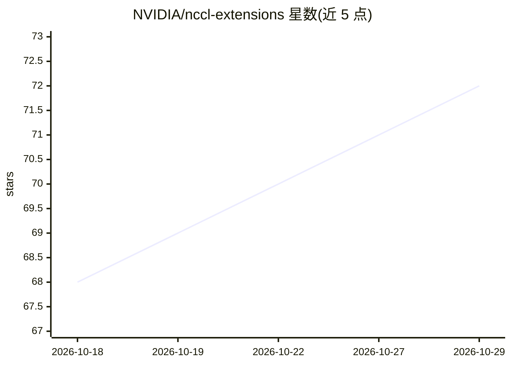

# NVIDIA/nccl-extensions

⭐ 72 · Cuda · NOASSERTION · 推送 2026-10-28 · [GitHub](https://github.com/NVIDIA/nccl-extensions) · 组织维护

**面向 AI 训练的 GPU 通信模式库，基于 NCCL API**

NVIDIA 维护的通信库集合，构建于 NCCL 设备与主机 API 之上，用于加速 MoE token shuffle 与强化学习权重 rollout 等张量通信负载。包含三个部分：nccl_ep 提供 MoE token 路由的 dispatch/combine 原语；nccl_m2n 为实验性库，在两个不相交 GPU 进程组间（如训练与推理 ranks）零拷贝重分片张量；python 提供 Pythonic 绑定。限制：依赖特定 CUDA 版本 extra，锁定 NCCL 2.30.7，其他版本未验证；仓库声明内容持续开发、可能变化。

## 筛选速览

| 维度 | 判定 | 备注 |
|---|---|---|
| AI 角色 | `ai-ecosystem` | LLM/agent 周边工具 |
| 许可风险 | `none` | NOASSERTION |
| 部署形态 | `library` | 以包/库形式分发 |
| 模型依赖 | — | README 未给出锁定关系 |
| 硬件要求 | — | 无带数字的原话,不猜 |
| 安装摩擦 | `medium` | 含编译或系统依赖之一 |
| 成熟度 | `idea` | |

## 能力要点

- 基于 NCCL 设备 API 的 MoE dispatch/combine 原语（nccl_ep）
- 跨进程组单次零拷贝张量重分片（nccl_m2n，实验性）
- 提供 nccl-extensions Python 包（nccl.ep / nccl.m2n 绑定）
- PyPI 预编译 wheel 支持 Linux x86-64/aarch64，CPython 3.10-3.14

## 适用场景

- MoE 训练中做 token 路由通信加速
- 训练与推理进程组间做权重 rollout/重分片
- 在 Python/JAX 等工作流中调用 NCCL 通信原语

## 场景标签

 · 领域:AI 基础设施/分布式通信

## 证据(README 行号)

> L3: NCCL Extensions is a repository of communication patterns for AI use cases,
> L14: Optimized dispatch and combine primitives for Mixture-of-Experts (MoE) token
> L18: Experimental library for resharding a tensor between two disjoint groups of

## 星数曲线

2026-10-18 68 → 2026-10-29 72（+4）

---
*卡片 v1 · prompt 1.4 · 生成 2026-10-24 · 置信度 high · 依据 README sha `92d01db785cb` · [字段定义](../../DATASET.md)*
