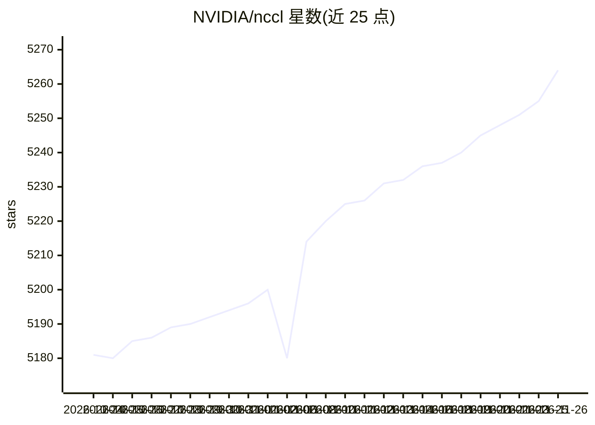

# NVIDIA/nccl

⭐ 5,264 · C++ · NOASSERTION · 推送 2026-11-24 · [GitHub](https://github.com/NVIDIA/nccl) · [官网](https://docs.nvidia.com/deeplearning/nccl/user-guide/docs/index.html) · 组织维护

**面向 GPU 的多卡集合通信原语库（NCCL）**

NVIDIA 维护的独立 C 库，实现 all-reduce、all-gather、reduce、broadcast、reduce-scatter 等集合通信例程及任意 send/receive 模式，针对 PCIe、NVLink、NVSwitch 以及 InfiniBand Verbs、TCP/IP 网络优化带宽，支持单节点或多节点任意数量 GPU，可在单进程或多进程（如 MPI）应用中使用。源码通过 make 构建，可打包为 deb/rpm/tarball/Python wheel 安装，官方预编译版本另行提供。

## 筛选速览

| 维度 | 判定 | 备注 |
|---|---|---|
| AI 角色 | `ai-ecosystem` | LLM/agent 周边工具 |
| 许可风险 | `none` | NOASSERTION |
| 部署形态 | `None` |  |
| 模型依赖 | — | README 未给出锁定关系 |
| 硬件要求 | — | 无带数字的原话,不猜 |
| 安装摩擦 | `high` | 编译与系统依赖俱全 |
| 成熟度 | — | 结构信号不足 |

## 能力要点

- 实现 all-reduce、all-gather、broadcast、reduce-scatter 等标准集合通信例程
- 支持 PCIe/NVLink/NVSwitch 与 InfiniBand Verbs、TCP/IP sockets
- 支持单节点或多节点任意数量 GPU，兼容 MPI 多进程应用
- 可构建 deb/rpm/tarball/Python wheel 包安装

## 适用场景

- 多 GPU 训练任务的集合通信后端
- 跨节点 GPU 集群中配置高速通信
- 多进程（MPI）GPU 应用中的卡间数据交换

## 场景标签

`模型训练` · 领域:训练与推理

## 证据(README 行号)

> L3: Optimized primitives for inter-GPU communication.
> L7: NCCL (pronounced "Nickel") is a stand-alone library of standard communication routines for GPUs, implementing all-re

## 星数曲线

2026-10-24 5,181 → 2026-11-26 5,264（+83）

---
*卡片 v1 · prompt 1.4 · 生成 2026-11-24 · 置信度 high · 依据 README sha `b37ba6cea036` · [字段定义](../../DATASET.md)*
